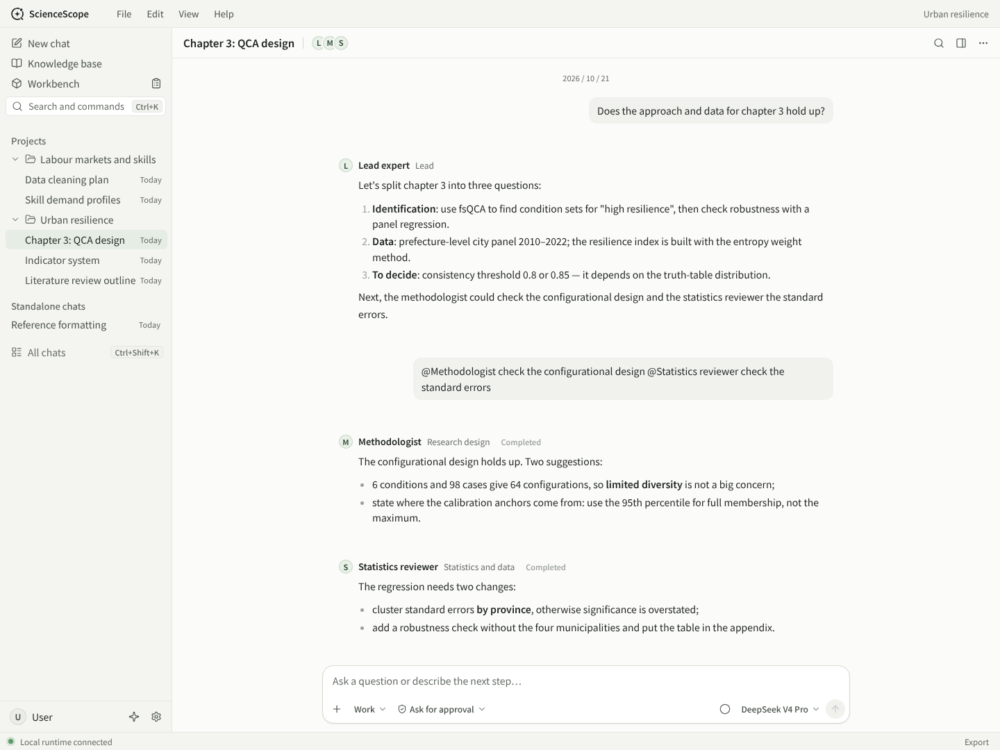
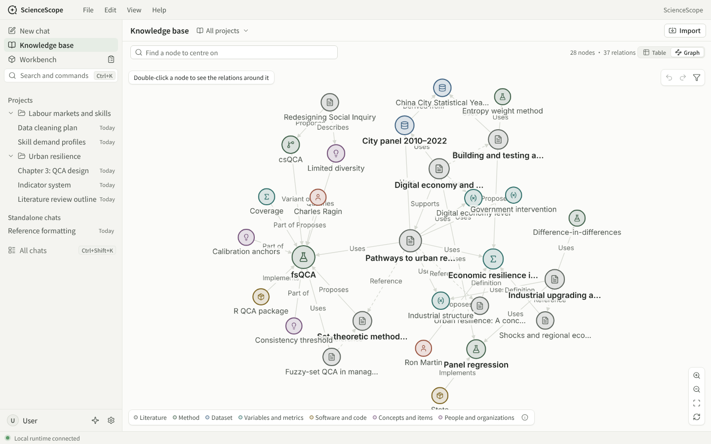
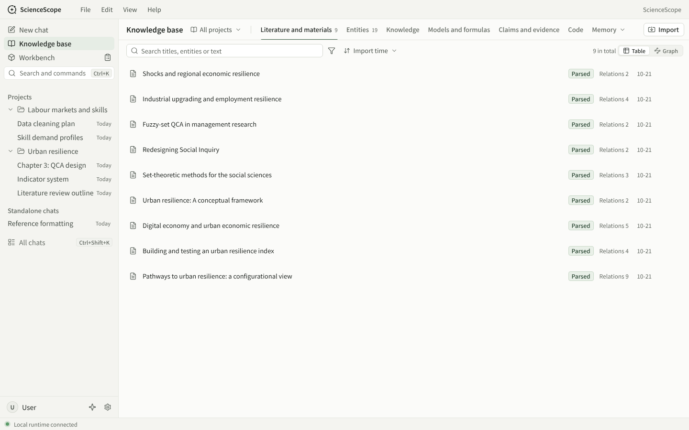
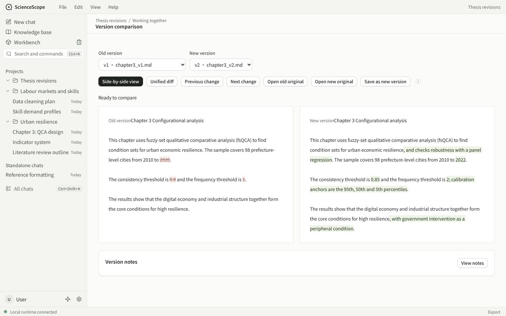
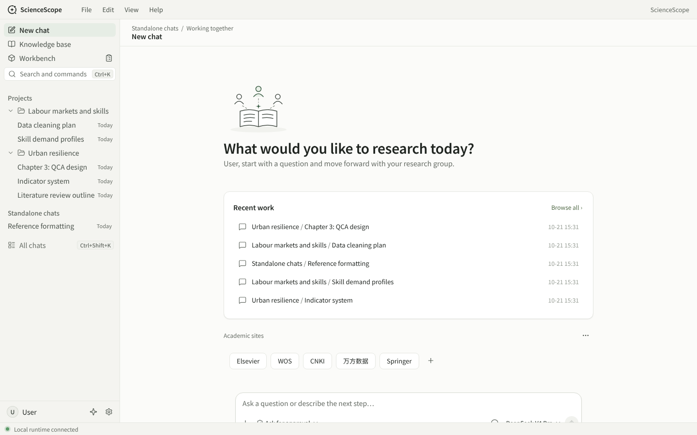
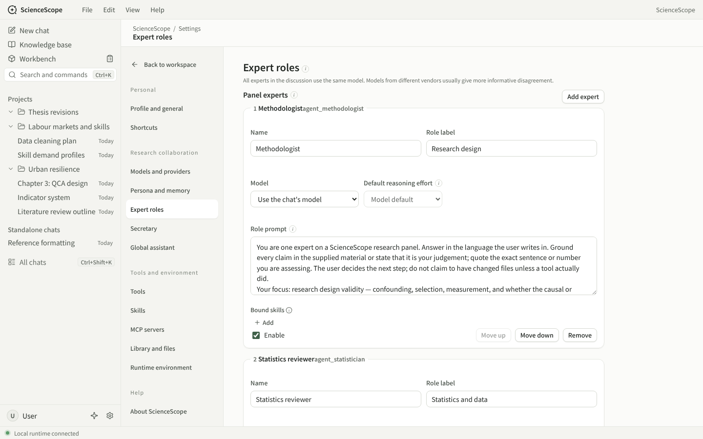

<p align="center">
  
</p>

<h1 align="center">ScienceScope</h1>

<p align="center">
  A research assistant that runs on your own computer: a small panel of AI experts reads sources, runs analyses and revises drafts with you, and remembers the whole history of your project.
</p>

<p align="center">
  <a href="README.zh-CN.md">简体中文</a> ·
  <a href="docs/README.md">Docs (Chinese)</a> ·
  <a href="docs/plans/ROADMAP.md">Roadmap</a> ·
  <a href="LICENSE">MIT</a>
</p>



> Status: `1.0.0-alpha.0` preview, working towards 1.0.0-alpha. There is no released installer yet, and preview builds are not code-signed. Projects and chats in the screenshots are demo data.

## What it does

Researchers usually carry one topic for months, with a pile of papers, data and drafts. ScienceScope wants the AI to do more than answer one question: it should remember where the project came from, be able to read, compute and write, and keep every step visible and reversible.

```
Import sources → experts discuss with you → secretary writes minutes and next steps → edit plans, maps, logs and drafts → pick up next time
```

**An expert panel.** A lead expert keeps working on the current task. Others, such as a methodologist, a statistics reviewer or a devil's advocate, can be @-mentioned to answer in parallel, or take turns in an ordered discussion with a reviewer checking at the end. Each expert can use a different model.

**Secretary and global assistant.** Every chat has a secretary that keeps minutes and drafts the next step; a global assistant works across projects and can open in its own window.

**Knowledge base.** All projects share one knowledge base of papers, methods, datasets, variables, software and people, and the relations between them. A relation only comes from a source passage or from something you said, and records where it came from; the model's own guesses stay out of the graph. Browse it as a table or as a graph. The graph loads by viewport: on a 50,000-node synthetic graph the median pan frame is about 16.7 ms.



| Literature and materials | Comparing manuscript versions |
|---|---|
|  |  |

**Workbench.** Plans, mind maps, logs and manuscript versions that both you and the AI can edit. Every change is saved as a version you can restore, and two versions can be compared side by side, word by word.

**The AI can act, but asks first.** All roles share one tool set: read and write project files, run Python, look at images, read web pages. The default mode is "Ask for approval": the app asks before running a command or writing a file, and you can set "always allow" rules per project. Skills in `SKILL.md` format and MCP servers can be added.

**Models.** The runtime is built on [pi-ai](https://github.com/earendil-works/pi). Presets for the official DeepSeek API and the OpenCode Go subscription need only a key; other services in OpenAI or Anthropic format can be added.

**Your data stays with you.** Everything lives under `data/` in the install folder: plain files plus one SQLite database, readable without the app. Keys are stored separately under `data/secret/`.

**Two languages.** The whole interface is available in English and Chinese.

<details>
<summary>More screenshots</summary>

| Welcome page | Expert settings |
|---|---|
|  |  |

</details>

## Progress

| Area | Status |
|---|---|
| Chats and experts, ordered discussion, parallel @-mentions | Done |
| Runtime and model providers (pi-ai) | Done |
| Secretary, global assistant, memory | Done |
| Tools, skills, MCP | Done |
| Knowledge base: storage, indexing, table page, graph view, paper-card pipeline | Mostly done, being refined |
| Editing desk: docx / tex editing, version graph | Backend in progress, UI to come |
| Windows installer | Preview builds work; signing to be decided |

The current state is described in [`docs/product/FEATURES.md`](docs/product/FEATURES.md) and the plan in [`docs/plans/ROADMAP.md`](docs/plans/ROADMAP.md) (both in Chinese).

## Getting started

Requires Node 22.

```sh
npm ci --registry=https://registry.npmjs.org --replace-registry-host=always
                      # the lockfile points at npmmirror; inside China plain `npm ci` is faster
npm run start:app     # development build, data in .sciencescope-local/data
npm run check         # formatting, lint, type check and all tests (about 340)
npm run package       # Windows installer (NSIS), Windows only
```

Browser tests need Chromium. The build setup for the native Windows shell (Tauri) is in [`docs/process/NATIVE_SETUP.md`](docs/process/NATIVE_SETUP.md).

## Architecture

```
Tauri shell (Windows)
  └─ Node main process  app/
       ├─ core/       data layer: SQLite, events, projects, chats, messages, turns
       ├─ services/   expert scheduling, secretary, tools, knowledge base, versions, editing desk, MCP, Python environments
       ├─ runtime/    agent runtime (pi-ai + pi-agent-core), reached only through the runtime port
       ├─ server/     local HTTP API
       └─ ui/         interface: Preact + htm, no build step; the graph view uses Cytoscape.js
```

The knowledge base is three layers in the same SQLite file: model-free signals (citations, similarity), "paper cards" written by a cheap model, and deep extraction on demand. Retrieval seeds from hybrid search and then walks one hop of the graph. See [`docs/architecture/KNOWLEDGE_BASE.md`](docs/architecture/KNOWLEDGE_BASE.md) and [`docs/architecture/ARCHITECTURE.md`](docs/architecture/ARCHITECTURE.md).

## How it is built: Codex and Claude together

One researcher leads the project, and two AI coding assistants share the work:

- **Codex (OpenAI)** implements backend features from written task briefs on a Windows machine, runs real-model evaluations and installer acceptance, one `codex/*` branch per task.
- **Claude (Anthropic)** designs and builds the whole interface, reviews Codex's branches, fixes small issues, merges them, and writes the next brief.
- The author makes every product decision and does the final testing on their own machine.

The whole process is in the repository: every task brief in [`docs/plans/tasks/`](docs/plans/tasks/), the review checklist in [`docs/process/REVIEW_CHECKLIST.md`](docs/process/REVIEW_CHECKLIST.md), the acceptance rules in [`docs/process/ACCEPTANCE.md`](docs/process/ACCEPTANCE.md), a record of every merge in [`docs/log/IMPLEMENTATION_LOG.md`](docs/log/IMPLEMENTATION_LOG.md), and more than a hundred of the author's decisions with their reasons in [`docs/decisions/DECISIONS.md`](docs/decisions/DECISIONS.md). Development rules are in [`AGENTS.md`](AGENTS.md). The docs are in Chinese.

## Repository layout

| Folder | Contents |
|---|---|
| `app/` | The new core: data, services, runtime, HTTP API and interface |
| `src-tauri/` | Native Windows shell |
| `tools/` | Packaging scripts and brand assets |
| `docs/` | Documentation, starting at [`docs/README.md`](docs/README.md) |
| `ScienceScope.html`, `reference/` | Visual baseline: the source of the logo, colours and art style |

## License and credits

[MIT](LICENSE). Publisher: **peroperoyui**. Contributors: **Codex** (OpenAI, AI-assisted development) and **Claude** (Anthropic, AI-assisted design, review and development). This credit is not a Windows code signature.
