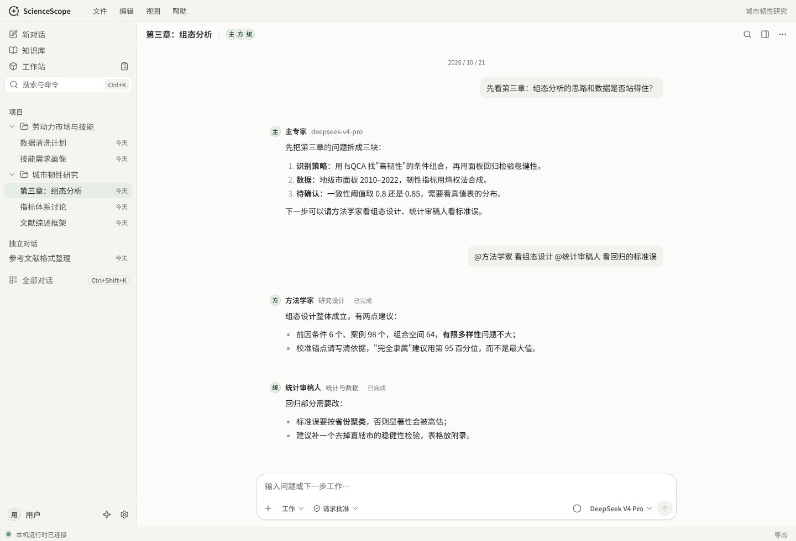
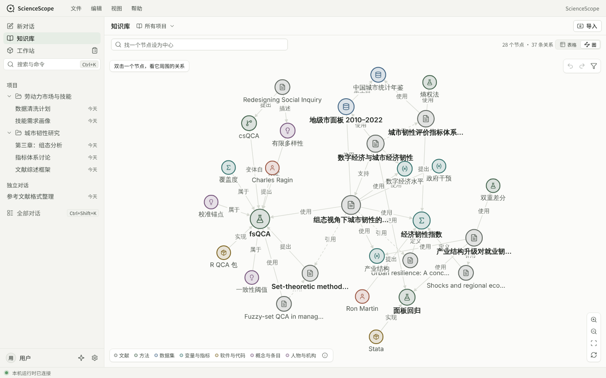
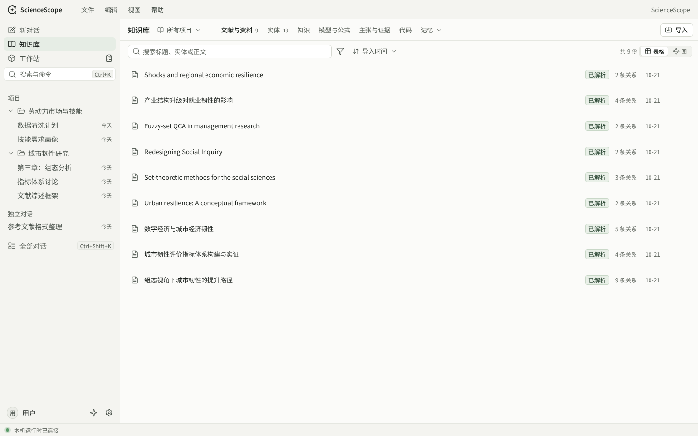
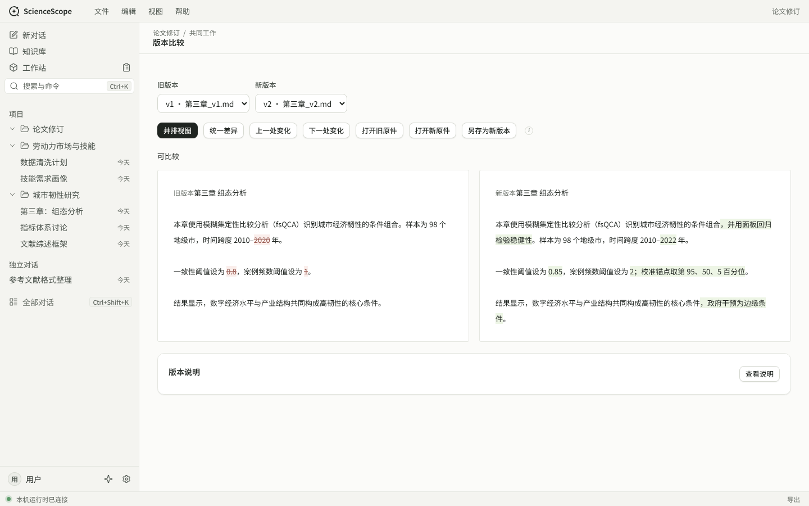
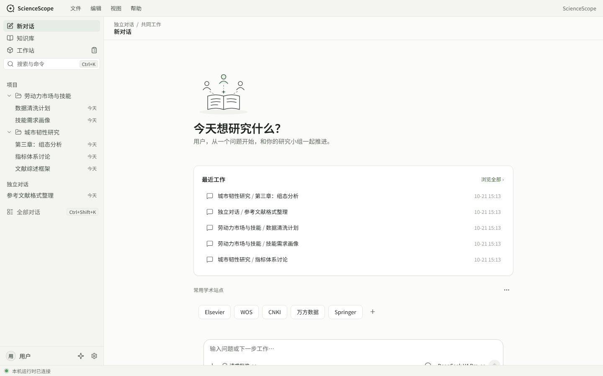
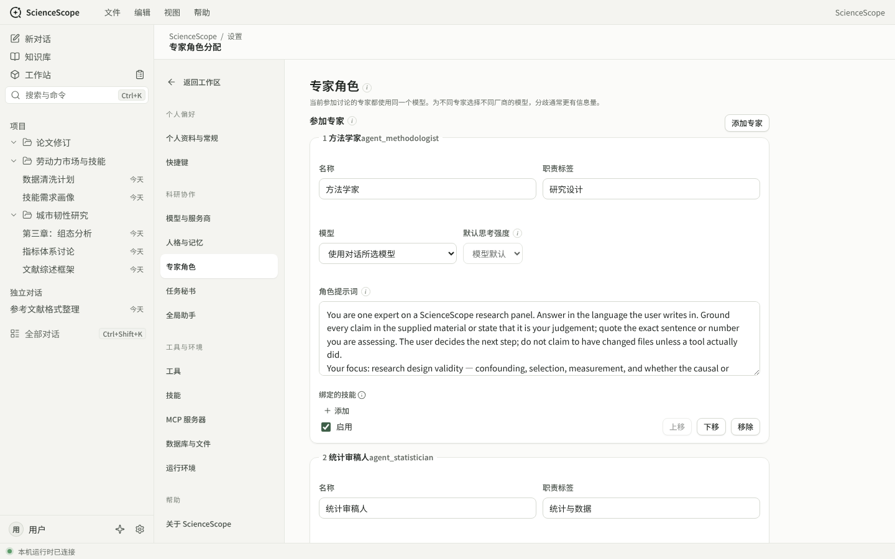

<p align="center">
  
</p>

<h1 align="center">ScienceScope</h1>

<p align="center">
  在本机运行的学术研究助手：几位 AI 专家和你一起讨论，读资料、做分析、改文稿，并记得整个项目的来龙去脉。
</p>

<p align="center">
  <a href="README.md">English</a> ·
  <a href="docs/README.md">文档</a> ·
  <a href="docs/plans/ROADMAP.md">路线图</a> ·
  <a href="LICENSE">MIT</a>
</p>



> 状态：`1.0.0-alpha.0` 预览，正在向 1.0.0-alpha 推进。还没有正式发布的安装包，预览包没有数字签名。截图里的项目和对话都是演示数据。

## 它能做什么

做研究的人手上往往有一个持续几个月的课题、大量文献和数据。ScienceScope 希望 AI 不只是回答一个问题，而是记得项目的来龙去脉，能动手读、算、写，并且每一步都看得见、改得回来。

```
导入资料 → 多位专家与你讨论 → 秘书整理纪要和下一步 → 修改计划、导图、日志与文稿 → 下次接着做
```

**专家小组。** 主专家持续处理当前任务；方法学家、统计审稿人、魔鬼代言人等可以被 @ 邀请并行作答，也可以在「有序讨论」里依次发言，最后由审核专家核查。每位专家可以用不同的模型。

**任务秘书和全局助手。** 每个对话有一位秘书整理纪要、起草下一步提案；全局助手跨项目查阅，可以单独成窗口。

**知识库。** 所有项目共用一个知识库：文献、方法、数据集、变量、软件、人物和它们之间的关系。关系只来自原文或你明确说过的话，每条都记着出处；模型自己的推断不会进图。可以按表格浏览，也可以按图浏览，图视图按视野加载，五万节点的合成数据下平移帧时间中位数约 16.7 毫秒。



| 文献与资料 | 文稿版本比较 |
|---|---|
|  |  |

**工作站。** 计划、导图、日志和文稿版本，人和 AI 都能改，每次修改都留下可以恢复的历史版本；两个版本可以并排逐词比较。

**AI 能动手，但要先问。** 所有角色共用一套工具：读写项目文件、运行 Python、查看图片、读网页。默认执行方式是「请求批准」：运行命令、写文件之前先问你，也可以按项目设置「总是允许」。还可以导入 `SKILL.md` 格式的技能、接入 MCP 服务器。

**模型。** 运行时基于 [pi-ai](https://github.com/earendil-works/pi)，内置 DeepSeek 官方接口和 OpenCode Go 订阅两个预设，只填密钥即可；也能添加其他 OpenAI 或 Anthropic 格式的兼容服务。

**数据在自己手里。** 所有内容都在安装目录的 `data/` 下：普通文件加一个 SQLite 数据库，离开应用也能读。密钥单独存放在 `data/secret/`。

<details>
<summary>更多截图</summary>

| 欢迎页 | 专家设置 |
|---|---|
|  |  |

</details>

## 进度

| 模块 | 状态 |
|---|---|
| 对话与专家、有序讨论、并行 @ | 完成 |
| 运行时与模型服务商（pi-ai） | 完成 |
| 任务秘书、全局助手、记忆 | 完成 |
| 工具、技能、MCP | 完成 |
| 知识库：存储、索引、表格页、图视图、论文卡片后台 | 主体完成，继续打磨 |
| 编辑台：docx / tex 编辑、版本图 | 后端进行中，界面待做 |
| Windows 安装包 | 预览包可用，正式签名待定 |

详细的现状见 [`docs/product/FEATURES.md`](docs/product/FEATURES.md)，计划见 [`docs/plans/ROADMAP.md`](docs/plans/ROADMAP.md)。

## 快速开始

需要 Node 22。

```sh
npm ci                # 锁文件指向 npmmirror；海外网络可加 --registry=https://registry.npmjs.org --replace-registry-host=always
npm run start:app     # 开发版，数据在 .sciencescope-local/data
npm run check         # 格式、lint、类型检查和全部测试（约 340 个）
npm run package       # Windows 安装包（NSIS），只在 Windows 上运行
```

浏览器测试需要 Chromium；Windows 原生外壳（Tauri）的构建环境见 [`docs/process/NATIVE_SETUP.md`](docs/process/NATIVE_SETUP.md)。

## 架构

```
Tauri 外壳（Windows）
  └─ Node 主进程 app/
       ├─ core/       数据层：SQLite、事件、项目、对话、消息、轮次
       ├─ services/   专家调度、秘书、工具、知识库、版本、编辑台、MCP、Python 环境
       ├─ runtime/    智能体运行时（pi-ai + pi-agent-core），只通过运行时接口接入
       ├─ server/     本机 HTTP 接口
       └─ ui/         界面：Preact + htm，无构建步骤；图视图用 Cytoscape.js
```

知识库是同一个 SQLite 文件里的三层：无模型信号（引用、相似度）、便宜模型生成的「论文卡片」、按需的深度抽取；检索是混合搜索做种子，再沿图走一跳。设计见 [`docs/architecture/KNOWLEDGE_BASE.md`](docs/architecture/KNOWLEDGE_BASE.md)，整体架构见 [`docs/architecture/ARCHITECTURE.md`](docs/architecture/ARCHITECTURE.md)。

## 怎么开发的：Codex 和 Claude 协作

这个项目由一位研究者主导，两个 AI 编程助手分工完成：

- **Codex（OpenAI）** 在 Windows 本机按任务书实现后端功能、跑真实模型评测和安装包验收，每个任务一个 `codex/*` 分支。
- **Claude（Anthropic）** 负责全部界面设计与实现，审阅 Codex 的分支、修小问题后合并，再写下一份任务书。
- 作者本人做所有产品决定，并在自己的机器上做最终测试。

整个过程都留在仓库里：每份任务书在 [`docs/plans/tasks/`](docs/plans/tasks/)，审阅清单在 [`docs/process/REVIEW_CHECKLIST.md`](docs/process/REVIEW_CHECKLIST.md)，验收规则在 [`docs/process/ACCEPTANCE.md`](docs/process/ACCEPTANCE.md)，每次合并的记录在 [`docs/log/IMPLEMENTATION_LOG.md`](docs/log/IMPLEMENTATION_LOG.md)，作者的一百多条决定和理由在 [`docs/decisions/DECISIONS.md`](docs/decisions/DECISIONS.md)。开发规则写在 [`AGENTS.md`](AGENTS.md)。

## 目录

| 目录 | 内容 |
|---|---|
| `app/` | 新核心：数据、服务、运行时、HTTP 接口和界面 |
| `src-tauri/` | Windows 原生外壳 |
| `tools/` | 打包脚本和品牌资源 |
| `docs/` | 文档，从 [`docs/README.md`](docs/README.md) 开始 |
| `ScienceScope.html`、`reference/` | 视觉基线：logo、配色和美术风格的来源 |

## 许可证与署名

[MIT](LICENSE)。Publisher：**peroperoyui**。Contributors：**Codex**（OpenAI，AI 辅助开发）、**Claude**（Anthropic，AI 辅助设计、审阅与开发）。此署名不是 Windows 数字签名。
