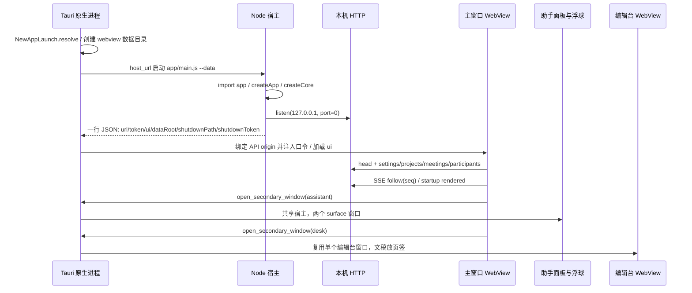

# ScienceScope 系统地图

> 核对日期：2026-10-30；代码基线：`main@d13583450531d3dc28ae3acfe4389fa044711074`。
> 本文描述该提交的实现；路径均相对于仓库根目录。`文件::函数` 是源码定位，冒号后的数字是该基线的行号。
> 表格的“出处”覆盖本行；段落末的出处覆盖该段。没有执行验证的因果判断标为“推断”。
> 启动耗时沿用 [P4b 报告](../handoff/reports/P4b.md) 的历史样本，本轮没有重新测量，也没有调用付费模型。

## 1. 技术栈

| 层 | 实际组件与版本 | 入口／版本出处 |
| --- | --- | --- |
| 应用 | JavaScript ESM，应用版本 `1.0.0-alpha.0` | `package.json:3`；`app/main.js:1` |
| 宿主 | 随包 Node `22.22.2`，Windows x64 | `tools/package/windows.js::downloadNode` |
| 类型检查 | JSDoc + TypeScript `5.9.3`，只检查不生成 JS | `package.json:13`；`app/tsconfig.json:1` |
| 原生 | Rust edition `2021`；Tauri 声明 `2`、锁定 `2.11.5` | `src-tauri/Cargo.toml:1`；`src-tauri/Cargo.lock:3699` |
| 原生构建 | tauri-build `2.6.3`；npm CLI `@tauri-apps/cli 2.12.2` | `src-tauri/Cargo.lock:3750`；`package-lock.json:2405` |
| WebView | tauri-runtime-wry `2.11.4`、wry `0.55.1`、webview2-com `0.38.2` | `src-tauri/Cargo.lock:3950`、`:5213`、`:4728`；`src-tauri/src/main.rs::main` |
| 原生插件 | dialog `2.7.3`、opener `2.5.5`、updater `2.10.1` | `src-tauri/Cargo.toml:12`；`src-tauri/Cargo.lock:3828`、`:3870`、`:3892`；`src-tauri/src/main.rs::main` |
| 组件 | Preact `11.0.0` + htm `3.1.1` | `package.json:16`；`app/ui/main.js:1`、`app/ui/html.js:1` |
| 浏览器加载 | 原生 ES modules + import map | `app/ui/index.html:1`；`app/server/static.js::serveStatic` |
| Markdown | marked `18.0.13`、DOMPurify `3.4.16` | `package.json:16`；`app/ui/markdown.js:1`、`app/ui/readers/vendor.js:1` |
| 公式 | KaTeX `0.18.9`、MathLive `0.111.0` | `package.json:16`；`app/ui/components/desk-formula.js:1` |
| 字体 | Noto Sans SC variable `5.3.0` | `package.json:24`；`app/server/static.js::FONT_ROOT` |
| 文稿编辑 | ProseMirror model `1.25.12`／state `1.4.4`／view `1.42.6` | `package.json:16`；`app/ui/readers/vendor.js:1` |
| 文本编辑 | CodeMirror state `6.7.6`／view `6.43.13`／language `6.12.4` | `package.json:16`；`app/ui/readers/vendor.js:1` |
| 图 | Cytoscape `3.34.3`；graphology `0.26.0`、ForceAtlas2 `0.10.1` | `package.json:16`；`app/ui/components/knowledge-graph.js:1`、`app/services/knowledge/layout-compute.js:1` |
| HTTP | Node 内置 `node:http`；自有路径匹配器 | `app/server/server.js::createAppServer`；`app/server/router.js::createRouter` |
| 数据库 | Node 内置 `node:sqlite` 的 DatabaseSync，WAL + FTS5 | `app/core/db/database.js::openDatabase`；`app/core/db/migrations/003-research-base.js::up` |
| 向量数据库扩展 | sqlite-vec `0.1.9` | `package.json:16`；`app/services/research/semantic/vector-store.js:1` |
| 模型请求与循环 | pi-ai `1.0.0`、pi-agent-core `1.0.0` | `package.json:16`；`app/runtime/pi/runtime.js:1` |
| MCP | `@modelcontextprotocol/sdk 1.32.1` | `package.json:16`；`app/services/mcp/connection.js:1` |
| 本地嵌入 | Transformers.js `4.3.0` tokenizer + onnxruntime-node `1.30.0` | `package.json:16`；`app/services/research/semantic/embedding-worker.js::load/embed` |
| 嵌入权重 | multilingual-e5-small，revision `761b726dd34fb83930e26aab4e9ac3899aa1fa78` | `models/default-embedding.json:2` |
| PDF | pdfjs-dist `6.3.289`；@napi-rs/canvas `1.0.9` | `package.json:16`；`app/services/research/parsers/pdf.js:1` |
| DOCX | JSZip `3.10.1`、saxes `6.0.0`、mammoth `1.12.3`；预览 docx-preview `0.4.1` | `package.json:16`；`app/services/desk/docx/`、`app/services/research/parsers/`、`app/ui/readers/vendor.js:1` |
| 差异 | diff `9.0.0` | `package.json:16`；`app/services/desk/diff.js:1` |
| Python | 内置清单 Python `3.14.7`，uv `0.12.19` | `python/builtin.json:1`；`app/services/python/index.js::ensureBuiltin` |
| 命令与 Job 辅助 | Windows 优先 pwsh，回退系统 PowerShell 5 路径；C# 由系统 .NET csc 编译，系统版本未锁定 | `app/services/builtin-tools/shell.js::shellCommand`；`tools/package/shell-job.js::compileShellJob` |
| 打包 | esbuild `0.28.2` + Tauri NSIS，当前用户安装 | `package.json:9`；`tools/package/windows.js:1`、`tools/package/bundle.js::bundleRuntime` |
| 检查 | Prettier `3.9.9`、ESLint `9.39.5`、node:test | `package.json:14` |
| 浏览器验收 | playwright-core `1.63.0` + 已装 Chromium／Edge | `package.json:61`；`app/ui/browser-testing.js::withBrowserApp` |

版本如何读：以上 npm 直接依赖逐项与 `package-lock.json:6` 核对一致；Rust 的范围声明和锁定值分别列出。
`package.json` 没有 `engines` 字段，22.22.2 是打包脚本的固定值，不是 package.json 的引擎范围。
WebView2 的实际浏览器引擎由 Windows 安装环境提供，Cargo 锁定的是 Rust 桥接库。
出处：`package.json`；`tools/package/windows.js::downloadNode`；`src-tauri/Cargo.lock:4728`。

本轮只读命令 `node -p "process.versions.sqlite"` 在上述 Node 22.22.2 返回 `3.51.2`。
SQLite 没有独立 npm 驱动版本；项目直接构造 `DatabaseSync`，测试替身也从这层进入。
出处：`app/core/db/database.js::openDatabase`；`app/testing.js::withCore`。

### 浏览器与发行包的两种“打包”

- 开发时 `index.html` 的 import map 将 Preact、htm 等映射到 `/vendor/*`，应用自身模块原样从 `app/ui/` 服务。
  出处：`app/ui/index.html:1`；`app/server/static.js::VENDOR/locate/serveStatic`。
- 阅读器是例外：首次请求 `/vendor/reader.js` 时 esbuild 生成并缓存内存 bundle，`write:false`。
  出处：`app/server/static.js::serveStatic` 的 `readerBundle` 分支。
- 发行包将后端 JS 依赖拆为 `runtime/chunks/`，保留源码相对入口和 worker 位置；前端模块仍直接加载。
  阅读器依赖在 stage 预打包；不要把“前端无整站构建”理解成“发行包完全没有 esbuild”。
  出处：`tools/package/bundle.js::bundleRuntime` 的 entries、retain-module-positions、reader 构建。
- Node 原生模块、模型推理库、PDF 资源和 CLI 启动器保留实体文件，程序清单用于覆盖升级差量清理。
  出处：`tools/package/bundle.js::externalPackages/copyExternalClosure`；`tools/package/program-manifest.js::writeProgramManifest`。

### 本地计算的准备时机

- 嵌入清单固定 384 维、512 tokens、batch 8；worker 从本地权重加载，不让 tokenizer 自行联网。
  出处：`models/default-embedding.json:1`；`app/services/research/semantic/embedding-worker.js::load`。
- 语义检索默认关闭，默认下载源为 ModelScope；下载与模型启用分开操作。
  出处：`app/core/defaults.js::DEFAULT_SEMANTIC_SETTINGS`；`app/services/research/semantic/index.js::download/configure`。
- Python 构造服务不等于安装环境；首次 `ensureBuiltin` 才读取 builtin 三份清单并调用 uv prepare。
  出处：`app/services/python/index.js::createPython/ensureBuiltin`；`app/services/python/installer.js::prepare`。
- Python 选择顺序是调用覆盖、会议绑定、项目绑定、全局默认、system；只向会议运行环境加入 PATH 与 VIRTUAL_ENV。
  出处：`app/services/python/index.js::selected/resolve`。
- uv 的 cache/interpreters/tmp 都在应用 Python 根下，显式清掉继承的 UV_/PIP_ 配置，再加入用户配置的源。
  出处：`app/services/python/uv.js::createUv/invoke`。

## 2. 进程与启动

图中调用链出处：`src-tauri/src/new_app.rs::NewAppLaunch`；`src-tauri/src/main.rs::host_url/main/open_secondary_window`；
`app/main.js:1` 顶层启动；`app/app.js::createApp`；`app/ui/actions.js::start`；`app/ui/main.js:1` 的 surface 分派。

### 启动位置与进程所有权

- release 用可执行文件旁的 `runtime/node.exe`、`app/main.js:1` 与 `data/`；debug 用仓库 Node/PATH 和忽略的数据根。
  `SCIENCESCOPE_DATA` 可显式覆盖，`SCIENCESCOPE_NODE` 可覆盖 Node；没有第二个旧宿主启动分支。
  出处：`src-tauri/src/new_app.rs::resolve/configure`；`src-tauri/src/main.rs::host_url`。
- 原生读取 readiness 一行的超时是 45 秒；stderr 写 `data/logs/desktop-host.log`，重启保留 previous 日志。
  出处：`src-tauri/src/main.rs::host_url`。
- Windows Node 被纳入 Job Object；普通主窗口关闭先请求 `/api/shutdown`，等最多 2 秒，再清整棵 Job。
  更新关闭使用单独的更严格等待流程，见 §5g。
  出处：`src-tauri/src/main.rs::windows_job/ChildHandle::shutdown/HostProcess::shutdown_for_update`。
- Node 内部还有嵌入、图布局、版本比较、导出 worker；shell、uv、MCP 可另起子进程。
  出处：`app/services/research/semantic/embedding.js:1`、`app/services/knowledge/layout.js:1`、`app/services/versions/diff-worker-client.js:1`、
  `app/services/export/index.js:1`、`app/services/builtin-tools/shell.js::runShell`、`app/services/python/uv.js::runProcess`、`app/services/mcp/connection.js:1`。
- `createApp.close` 依次停调度、审批、MCP、后台任务、HTTP、编辑台和索引，最后 runtime/semantic/core.close。
  出处：`app/app.js::createApp.close`；`app/main.js::shutdown`。

### 端口、令牌与窗口

- Node 默认监听 `127.0.0.1:0`，由系统分配端口；CLI `--port` 可指定。每次启动随机生成 32 字节 hex 口令。
  出处：`app/main.js:1` 的 parseArgs/randomBytes；`app/server/server.js::listen`。
- `/api/*` 用 Bearer 或 query token 鉴权，并以 timingSafeEqual 比较；静态文件不带业务数据，不要求口令。
  出处：`app/server/server.js::tokenMatches/createAppServer`；`app/server/static.js::serveStatic`。
- 原生把 host origin/token 注入页面；次级窗口沿用同一 host 与 `data/webview`，没有新建第二个 Node。
  出处：`src-tauri/src/main.rs::api_initialization/open_secondary_window`；`app/ui/api.js::createApi`。
- 主窗口不是 Tauri 默认自动创建：配置 `create:false`，等待 HTTP readiness 后才 build；界面入口按 surface 分派。
  出处：`src-tauri/tauri.conf.json:11`；`src-tauri/src/main.rs::main.setup`；`app/ui/main.js:1`。
- 助手面板和浮球都 `skip_taskbar(true)`；浮球 always_on_top；同一主进程可隐藏、展开、销毁它们。
  出处：`src-tauri/src/main.rs::open_secondary_window/apply_assistant_mode/hide_assistant`。
- 编辑台 label 固定 `secondary-desk`，再次打开向已有窗口发 `desk-open`；位置独立写 desk-window.json。
  出处：`src-tauri/src/main.rs::open_secondary_window`；`src-tauri/src/desk_window.rs::initialize/save`。

### 启动阶段的已有测量

沿用 [P4b §一.2 启动拆分表](../handoff/reports/P4b.md#2-启动时间拆分表)，单位 ms，热／冷各三次中位数：

| 阶段 | 热／冷 | 代码标记或观测点 |
| --- | --- | --- |
| 原生入口 → Node spawn | 15.00 / 32.00 | `src-tauri/src/main.rs::main/host_url` |
| Node 进程创建 | 79.33 / 2691.04 | `app/main.js:1` 的 performance.timeOrigin 与原生环境标记 |
| bootstrap／入口静态依赖／observer | 53.21 / 52.46 | `tools/perf/startup-observe.mjs:1` |
| 应用模块导入 | 653.99 / 614.35 | `app/main.js::appImportStart/appImportEnd` |
| createApp | 278.62 / 2132.75 | `app/main.js::createAppStart/createAppEnd` |
| 其中 core 包围区间 | 18.42 / 96.14 | `app/app.js::createCoreStart/createCoreEnd` |
| 其中 Python 构造 | 0.37 / 0.35 | `app/app.js::pythonStart/pythonEnd` |
| 其中 semantic.start | 3.27 / 3.53 | `app/app.js::semanticStart/semanticEnd` |
| HTTP 绑定 | 18.99 / 89.44 | `app/main.js::httpListenStart/httpListening` |
| HTTP 就绪 → 首屏渲染 | 5349.89 / 8012.47 | `app/server/startup-client.js::reportStartup` |
| 并行脚本请求区间 | 1189.80 / 1679.00 | `tools/perf/native-profile.mjs:1`；P4b 原样本 |
| 并行首屏 API 区间 | 550.90 / 971.10 | `tools/perf/native-measure.mjs:1`；P4b 原样本 |

这些是基线 `4cf4bfe` 的历史测量，不是本提交的性能承诺；嵌套和并行区间不相加。
P4b 使用已建好索引的数据，没有排队首次全扫；冷启动指清缓存后的启动。
出处：`docs/handoff/reports/P4b.md::方法与数据/2.启动时间拆分表`。

## 3. 模块地图

| 目录／模块 | 负责什么、对外入口 | 主要依赖方向 |
| --- | --- | --- |
| `app/core` | projects/participants/meetings/messages/turns/workspace/events/outbox；`app/core/index.js::createCore` 返回 Core | db、paths、文件资源；不导入具体 runtime |
| `app/runtime` | Runtime 契约、真实 pi 与 scripted；`app/runtime/port.js:1`、`app/runtime/pi/runtime.js::createPiRuntime` | pi SDK；catalog → services/providers、core/errors；sessions → export/sanitize；工具经回调执行 |
| `app/server` | HTTP、路由、静态资源、SSE；`app/server/server.js::createAppServer` | core + services；`app/server/router.js::createRouter` 匹配路径 |
| `app/shared` | 日志结构与文本块纯转换；`app/shared/journal.js:1`、`app/shared/text-blocks.js:1` | 可同时给浏览器和后端使用 |
| `app/ui` | 页面、组件、交互、store；`app/ui/main.js:1`、`app/ui/actions.js::createActions` | Preact/htm、API、shared、原生桥接 |
| `app/services/assistant` | 全局助手会议与跨项目概览；`app/services/assistant/index.js::createAssistant` | core + `app/services/assistant/overview.js::workspaceOverview` |
| `app/services/builtin-tools` | 文件、shell、网页、看图；`app/services/builtin-tools/index.js::createBuiltinTools` | fs/子进程/研究资料/Python；由 tools 注册 |
| `app/services/desk` | 编辑会话、DOCX/TeX/MD、批注、索引、编译；`app/services/desk/index.js::createDesk` | core、versions、projectFiles；docx 子目录处理 OOXML |
| `app/services/export` | 全量导出后台 worker、文件计划、脱敏副本；`app/services/export/index.js::createFullExport` | SQLite 快照、workspace、研究原件；经 server 调用 |
| `app/services/knowledge` | 实体边、修订版本、图、扫描、卡片、检索扩展 | `app/services/knowledge/store.js::createKnowledgeStore`、`app/services/knowledge/jobs.js::createKnowledgeJobs`；依赖 core/research/semantic |
| `app/services/mcp` | 配置、连接、工具发现与调用；`app/services/mcp/index.js::createMcp` | MCP SDK、凭据、进程；结果交共享工具层 |
| `app/services/memory` | 从纪要差异提取候选并核对、收件箱、简报；`app/services/memory/index.js::createMemoryService` | core、minutes、research、background runner |
| `app/services/preview` | 预览格式、原件／渲染资源定位；`app/services/preview/index.js:1` | 文件、研究原件、解析器；`app/server/routes/preview.js:1` 暴露 |
| `app/services/python` | 环境目录、绑定、包清单与安装记录；`app/services/python/index.js::createPython` | core、uv 子进程、builtin 清单 |
| `app/services/research` | sources/chunks/items、FTS、导入解析、混合搜索；`app/services/research/index.js::createResearch` | core/store、parsers、semantic；knowledge 扩展它 |
| `app/services/research-input` | 附件、引用、标记和模型输入编译；`app/services/research-input/index.js::createResearchInput` | core.inputRecords、research；`app/services/research-input/compile.js:1` 编译输入 |
| `app/services/secretary` | 纪要、附属秘书会话、后台一轮、工作台发布 | `app/services/secretary/minutes.js::createMinutesService`、`app/services/secretary/chat.js::createSecretaryChat`、`app/services/secretary/background.js::createBackgroundRunner` |
| `app/services/skills` | 技能发现、绑定、预载、按需读取；`app/services/skills/index.js::createSkills` | core、文件目录；由 contextAssembly/tools 使用 |
| `app/services/versions` | 稿件原件、分组/分支/层级/说明、比较缓存 | `app/services/versions/index.js::createVersions`、`app/services/versions/organizer.js::createVersionOrganizer`；core、desk 文本提取、worker |
| `app/services/conductor*.js` | 会议发言规则、排队、讨论审核和采纳 | `app/services/conductor.js::createConductor` → runner；读取 core.meetings/outbox |
| `app/services/turn-runner.js:1` | 一次发言的 DB 状态与 runtime 事件桥接 | `createTurnRunner` → contextAssembly、tools、Runtime |
| `app/services/context-assembly.js:1` | 上下文重建/增量、角色提示与附件/Python | `createContextAssembly` → core + 注入的技能、秘书、简报与助手投影 |
| `app/services/tools.js:1` | 一个工具注册表及工具执行路由 | `createTools` → workspace、research、knowledge、desk、skills、mcp、builtin |
| `app/services/approvals.js:1` / `app/services/approval-rules.js:1` | 待批准动作与持久“总是允许”规则 | `createApprovals`、`createApprovalRules` → core/settings/events |
| `app/services/providers.js:1` / `app/services/provider-*.js` | 服务商操作、header 引用、旧历史迁移 | `createProviderService`、`providerSettings`、`migrateProviderHeaders` → catalog/credentials/core |
| `app/services/project-files.js:1` | 外部文件树、打开、改名、回收站、索引钩子 | `createProjectFiles` → core.projects、fs、注入 projectIndex |
| `app/services/system.js:1` / `app/services/deliverables.js:1` | 本机路径打开、目录信息、交付物登记/定位 | `systemInfo/openFolder/openPath`、`createDeliverables` |
| `app/services/export.js:1` / `app/services/startup.js:1` | 对话 Markdown/项目导出入口；启动日志 | `meetingMarkdown/exportProject`；`createStartupLog` |

表内列的是实际构造函数与引用方向；完整装配的直接证据是 `app/app.js:1` 的 imports 和 `createApp`。
后端子目录不是 npm workspace 包；仓库根 `package.json` 安装统一依赖。
出处：`app/app.js::createApp`；`package.json`。

实际存在的反向引用也要保留在地图里：`app/runtime/pi/catalog.js:14` 读取 services/providers 的凭据函数，`app/runtime/pi/sessions.js:4` 调用 services/export/sanitize 的工具参数脱敏。
services 的部分模块又使用 runtime/port 的结果整形函数；它们依赖的是端口辅助代码。出处：`app/services/secretary/background.js:6` 的 recordedToolResult import。

### createApp 的装配次序

1. `createCore` 打开 DB、迁移、默认参与者，注入带凭据 prepare 的 settings 资源；随后运行 header 历史迁移。
   出处：`app/app.js::createApp`；`app/core/index.js::createCore`；`app/services/provider-settings.js::providerSettings`。
2. 构造 versions、knowledge/store/layout、knowledgeSessions，并 recover；再构造 semantic、research、projectFiles、projectIndex、desk。
   出处：`app/app.js::createApp` 的 versions 至 desk 区间。
3. 构造 researchInput、Python，等待 semantic.start；catalog 的 providers 回调每次读 settings，runtime 可由测试传入替换。
   出处：`app/app.js::createApp` 的 settings/catalog/activeRuntime。
4. 装配 cards/jobs、minutes/secretary、skills/MCP/tools、versionNotes、memoryRunner/memory、assistant。
   出处：`app/app.js::createApp` 的 createPaperCards 至 createAssistant。
5. 注入 contextAssembly 的 minutesCoverage、followup、assistantOverview、projectBrief，再建 runner 和 conductor。
   出处：`app/app.js::createApp` 的 contextAssembly/runner/conductor。
6. 启动 conductor/minutes/memory/versionNotes 的订阅；将全部服务交 createAppServer，返回服务对象和 listen/close。
   出处：`app/app.js::createApp` 返回值；`app/server/server.js::createAppServer`。

### 怎样进入一个功能

- 从 HTTP 找：在 `app/server/server.js::createAppServer` 找 register，再到 `routes/*::register…Routes` 看 handler。
  例如 settings 进入 `app/server/routes/workspace.js::registerWorkspaceRoutes`，知识库进入 `app/server/routes/knowledge.js::registerKnowledgeRoutes`。
- 从 AI 工具找：从 `app/services/tools.js::createTools` 的 specs/run 往下；不要以 UI 文案猜工具名。
  内置工具 spec 在 `app/services/builtin-tools/index.js::BUILTIN_SPECS`；MCP 清单在运行时发现后合并。
- 从页面找：`app/ui/main.js:1` → `app/ui/components/app.js:1` 或独立 surface；动作集中 `app/ui/actions.js:1` 与各 `*-actions.js`。
  网络入口 `app/ui/api.js::createApi`，事件落点 `app/ui/state.js::applyEvent`。
- 从数据找：先 `app/core/paths.js::dataPaths`，再迁移和资源 locate；同名“版本”可能是资源快照、知识库版本或稿件版本。
  出处：`app/core/workspace/snapshots.js:1`；`app/services/knowledge/versions.js:1`；`app/services/versions/index.js:1`。

这张地图记录当前实现边界，不把“路由只转发”“服务完全解耦”写成已验证的事实。
已知跨层和职责问题集中引用 §10 的 P4b 编号，避免新开发者把设计规则误当静态检查。
出处：`docs/handoff/reports/P4b.md::二、后端结构体检`；`app/server/routes/meetings.js:1`、`app/server/routes/memory.js:1`。

## 4. 数据落点与数据库

| 相对 `data/` 的落点 | 实际内容 / 所有者 | 代码证据 |
|---|---|---|
| `sciencescope.sqlite` | 主数据库；开启 WAL、外键、5 秒 busy timeout | `app/core/paths.js:dataPaths`；`app/core/db/database.js:openDatabase` |
| `settings.json` | 工作区 settings 资源；配置经资源修订机制读写 | `app/core/paths.js:dataPaths`；`app/core/workspace/resources/settings.js:settings` |
| `agents/`、`skills/` | 专家定义和技能根目录 | `app/core/paths.js:dataPaths`；`app/core/workspace/resources/documents.js:agent`；`app/services/skills/index.js:createSkills` |
| `projects/<dir_name>/` | 项目所属数据；`dir_name` 由可读名加 ID 组成 | `app/core/workspace/workspace.js:createWorkspace.locate.projectDir`；`app/core/paths.js:projectDirName` |
| `projects/<dir_name>/workbench/map.json` | 研究导图资源 | `app/core/workspace/resources/map.js:map.file` |
| `projects/<dir_name>/workbench/plans.md`、`log.md` | 项目计划与日志 | `app/core/workspace/resources/documents.js:plans`、`log` |
| `projects/<dir_name>/minutes/<meetingId>.md`、`notes/` | 项目纪要、命名笔记 | `app/core/workspace/resources/documents.js:minutes`、`notes` |
| `minutes/<meetingId>.md`、`plans.md` | 无项目会议纪要、全局计划 | `app/core/workspace/workspace.js:createWorkspace.locate.meetingBase`；`app/core/workspace/resources/documents.js:minutes`、`plans` |
| `projects/<dir_name>/versions/<groupId>/v<number>-<versionId>/<filename>` | 每个稿件版本的原始字节；同目录 `<filename>.notes.md` 为版本说明 | `app/services/versions/storage.js:createVersionStorage.writer.stageVersion`；`app/core/workspace/resources/versions.js:versionNotesResource.file` |
| `projects/<dir_name>/desk/<sessionId>/` | 编辑工作副本；`.state/source.<format>` 与 `.state/checkpoint.json` 用于恢复 | `app/services/desk/sessions.js:createDeskSessions.paths`、`initialize`、`load` |
| `library/originals/<uuid>.<ext>` | 手动导入的资料原件 | `app/services/research/index.js:createResearch.importSource` |
| `library/project-files/<projectId>/<contentHash>` | 项目文件按 SHA-256 保留不可变副本 | `app/services/knowledge/project-copies.js:snapshotProjectFile` |
| `mcp/npm-cache/`、`mcp/uv-cache/` | MCP 包启动器缓存，不与用户全局缓存混用 | `app/services/mcp/connection.js::commandOptions` |
| `deliverables/` | 对话交付文件根目录 | `app/core/paths.js:dataPaths`；`app/services/deliverables.js:createDeliverables` |
| `runtime/`、`logs/`、`models/`、`python/`、`backups/` | 运行、日志、本地模型、Python、迁移备份根目录 | `app/core/paths.js:dataPaths`；`app/core/db/database.js:openDatabase` |
| `secret/credentials.yaml` | YAML `{version, refs}`；服务商配置引用 `keyRef` | `app/services/providers.js:credentialsFile`、`readCredentials`、`saveKeys` |
| `runtime/pi/sessions/<sessionId>.json` | pi 工作记忆，独立于规范会议消息 | `app/runtime/pi/sessions.js::sessionStore` |
| `logs/model-requests.jsonl` | 模型请求统计与轮换日志；实际文件名由 createRequestLog 定义 | `app/runtime/pi/request-log.js::createRequestLog` |
| `webview/`、`assistant-window.json`、`desk-window.json` | WebView 目录与原生窗口尺寸/位置 | `src-tauri/src/main.rs::main`；`src-tauri/src/desk_window.rs::persist` |
| 用户选择的项目目录 | `projectFiles.rootOf()` 优先项目 `folder`，未选则用项目所属数据目录 | `app/services/project-files.js:createProjectFiles.rootOf` |

### 4.1 编号迁移：按领域列出全部建表、改表、删表

| 领域 | 编号与迁移文件（均为 `app/core/db/migrations/` 下 `up`） | 新建表 | 改表 / 删除 / 数据迁移 |
|---|---|---|---|
| 核心身份与会话 | `app/core/db/migrations/001-core.js:up` | `projects`、`participants`、`meetings`、`meeting_members`、`messages`、`turns`、`tool_calls`、`runtime_sessions`、`revisions`、`events` | 创建项目、参与者、会议、消息、执行、修订、事件基础模式 |
| 核心工具调用 | `app/core/db/migrations/002-tool-preamble.js:up` | — | `tool_calls` 加 `preamble`、`call_id`；建立调用和 turn 查询索引 |
| 核心运行活动 | `app/core/db/migrations/018-turn-activities.js:up` | — | `turns.phase`、`tool_calls.kind` |
| 核心运行错误 | `app/core/db/migrations/019-turn-error.js:up` | — | `turns.error` |
| 核心资源历史 | `app/core/db/migrations/008-resource-snapshots.js:up` | `resource_snapshots` | `revisions.restored_from_revision_id` |
| 资料与检索 | `app/core/db/migrations/003-research-base.js:up` | `rb_sources`、`rb_chunks`、`rb_items`、`rb_revisions`、虚表 `rb_fts` | FTS5 关键词投影 |
| 资料与检索 | `app/core/db/migrations/004-research-vectors.js:up` | `rb_vec_docs`、虚表 `rb_vec` | 加载 sqlite-vec；`vec0` 为 384 维，按模型 ID / 版本分区 |
| 资料与图谱 | `app/core/db/migrations/022-knowledge-base.js:up` | `kb_entities`、`kb_edges`、`kb_labels`、`kb_memberships`、`kb_versions`、`kb_revisions`、`kb_jobs` | `rb_sources.folder_path` 及项目路径唯一索引 |
| 资料与项目索引 | `app/core/db/migrations/023-project-file-index.js:up` | — | `rb_sources.file_size`、`file_mtime_ms`、`content_hash` |
| 资料与论文卡片 | `app/core/db/migrations/025-paper-cards.js:up` | — | `kb_entities.produced_from`、`evidence_json`；`kb_jobs.result_json`、`meeting_id`、`manual` |
| 资料与图布局 | `app/core/db/migrations/026-knowledge-positions.js:up` | `kb_positions` | 以 ref 为主键保存全局共享坐标与 pinned 状态 |
| 纪要与秘书 | `app/core/db/migrations/005-meeting-minutes.js:up` | `minutes_coverage`、`minutes_status`、`minutes_workbench_updates`、`secretary_pending_projects` | 覆盖、错误状态、工作站同步与离开项目待办 |
| 纪要与秘书 | `app/core/db/migrations/006-secretary-chats.js:up` | `secretary_chats`、`secretary_cursors`、`main_draft_proposals`、`main_draft_proposal_history` | 私聊映射、游标、主专家指令提案及历史 |
| 记忆整理 | `app/core/db/migrations/007-memory-consolidation.js:up` | `memory_cursors`、`memory_checkpoints`、`memory_runs`、`memory_dedup`、`memory_item_history` | 增量游标、恢复检查点、运行状态、去重、条目历史 |
| 对话发送队列 | `app/core/db/migrations/009-meeting-outbox.js:up` | `meeting_outbox_state`、`meeting_outbox` | 会议发送队列与状态 |
| 对话交付 | `app/core/db/migrations/010-message-deliverables.js:up` | `message_deliverables` | 消息到交付文件映射 |
| 全局助手 | `app/core/db/migrations/011-global-assistant.js:up` | `assistant_state` | 助手持久状态 |
| 研究输入 | `app/core/db/migrations/012-research-input.js:up` | `research_input_drafts`、`message_research_input` | `meeting_outbox.input_json` |
| 输入图片 | `app/core/db/migrations/020-input-images.js:up` | `input_images` | 图片附件记录 |
| Python 环境 | `app/core/db/migrations/013-python-environments.js:up` | `python_environments`、`python_bindings`、`python_operations` | 环境、项目绑定、安装等操作状态 |
| 已退役自动化 | `app/core/db/migrations/014-meeting-goals.js:up` | `meeting_goals` | 当时的会议目标表 |
| 已退役自动化 | `app/core/db/migrations/021-remove-automation.js:up` | — | `meetings.policy_json.mode` 的 `autonomous` 改 `direct`，删除 policy `goal`；DROP `meeting_goals` |
| 稿件版本 | `app/core/db/migrations/015-manuscript-versions.js:up` | `version_groups`、`manuscript_versions` | 版本组、序号、原件、说明与基线 |
| 稿件版本说明 | `app/core/db/migrations/016-version-notes.js:up` | `version_note_meetings` | `projects.auto_version_notes`；`manuscript_versions.notes_references_json`、`notes_turn_id` |
| 工作站日志引用 | `app/core/db/migrations/017-log-file-references.js:up` | `log_file_references` | 日志与文件引用 |
| 编辑台版本图 | `app/core/db/migrations/024-version-graph.js:up` | `desk_sessions`、`desk_changes` | `version_groups.source_path`、`format`；版本加 `parent_id`、`branch`、`tier`、`label`、`title`、`origin`、`content_hash`、`session_id` |
| 编辑台源文件同步 | `app/core/db/migrations/027-desk-source-sync.js:up` | — | `version_groups.source_hash`、`source_version_id` |
| 编辑台版本差异 | `app/core/db/migrations/028-version-diffs.js:up` | `version_diffs` | 基线 / 版本对的算法版本与差异 JSON 缓存 |
| 编辑台批注索引 | `app/core/db/migrations/029-desk-annotations.js:up` | `manuscript_bindings`、`manuscript_comments` | `desk_changes.annotations_json` |
| 编辑台版本标记 | `app/core/db/migrations/030-version-marks.js:up` | — | `manuscript_versions.description`、`is_key` |

机械盘点：编号文件为连续 001–030，全部由 `app/core/db/migrations/index.js:migrations` 注册；各 `up` 共显式建 59 个命名表（含两类虚表），DROP 后剩 58 个；此口径不数 SQLite 虚表影子表。
迁移执行以 `PRAGMA user_version` 为准；旧库先备份，每个迁移与版本号同事务；遇到比程序更新的库返回 `DATA_TOO_NEW`。（`app/core/db/database.js:openDatabase`）
`revisions` 记录资源逐次修改，`resource_snapshots` 记录可恢复历史版本；图谱另有 `kb_versions/kb_revisions`，编辑台另有 `desk_changes` 和稿件原件版本。（`app/core/workspace/workspace.js:createWorkspace`；`app/core/workspace/snapshots.js:createSnapshots`；`app/services/knowledge/versions.js:createKnowledgeVersions`；`app/services/desk/storage.js:createDeskStore`）

### 4.2 凭据与全量导出

当前 provider 自定义 header 和 MCP headers/env 的配置字段都保存 `{keyRef}`；连接时才读取 YAML 中的值。出处：`app/services/providers.js::storeProviderHeaders/resolveProviderHeaders`；`app/services/mcp/config.js::createMcpConfig.save/resolve`。
启动期还会先备份、再清理历史 settings 修订、资源快照、工具记录与事件中的 header 值；运行时旧会话另做文件备份和原子替换。备份保留迁移前内容，导出会排除备份目录。出处：`app/services/provider-header-migration.js::migrateProviderHeaders`；`app/services/provider-session-migration.js::migrateProviderSessions`；`app/services/export/writer.js::createExportWriter`。

1. 凭据由 `saveKeys()` 串行写 YAML；公开服务商设置保留引用名，`keyRefs()` 只列引用名。（`app/services/providers.js:saveKeys`、`keyRefs`）
2. `createFullExport.start()` 校验目标并预留带“未完成”后缀的目录，启动 worker；同一时刻复用已有活动任务。（`app/services/export/index.js:createFullExport.start`；`app/services/export/paths.js:reserveFolder`）
3. worker 用 `VACUUM INTO` 获取 SQLite 快照，随后对副本脱敏；导出读同一份数据库快照。（`app/services/export/worker.js:39` 顶层 worker 流程；`app/services/export/sanitize.js:sanitizeSnapshot`）
4. 计划顺序是项目、会议、知识、配置、数据库记录；输出 Markdown / JSON、稿件原件与说明、知识原件及含向量的数据库。（`app/services/export/plan.js:planExport`；`app/services/export/projects.js:planProjects`；`app/services/export/content.js:planKnowledge`）
5. provider header、MCP header / env 明文及历史副本由 `sanitizeSnapshot()` 替换；重算相关文本哈希并 VACUUM 清理旧页。（`app/services/export/sanitize.js:sanitizeSnapshot`）
6. writer 排除 `secret`、`logs`、`backups`、`runtime`、Python 环境、`models`、`webview`，也不沿符号链接复制。（`app/services/export/writer.js:createExportWriter`、`tree`、`source`）
7. 外部项目目录不复制；库内项目文件副本由 `includeProjectCopies` 决定，默认 false；缺失或跳过文件列入 `未复制文件.json`。（`app/services/export/projects.js:planProjects`；`app/services/export/content.js:planKnowledge`；`app/services/export/plan.js:planExport`）
8. 成功才去掉目录“未完成”后缀；取消或失败保留部分结果；任务状态是 host 内存态。（`app/services/export/index.js:createFullExport.execute`、`start`）

## 5. 关键数据流

| 场景 | 开始入口 | 核心经过 | 最终落点 |
| --- | --- | --- | --- |
| a. 发消息 | `app/ui/actions.js::postMessage` | `app/services/conductor.js::submit` → `app/services/turn-runner.js::createTurnRunner` | messages/turns/tool_calls；SSE → `app/ui/state.js::applyEvent` |
| b. 多专家 | `app/services/conductor.js::runDirect` / `app/services/conductor-round.js::runRound` | 并行专家、审核、采纳 | `app/core/messages.js::update` 与后续 context |
| c. 后台整理 | `app/services/secretary/minutes.js::start`、`app/services/memory/index.js::start` | 后台 runner 与各自持久队列/游标 | 纪要、候选记忆、版本说明、论文卡片 |
| d. 资料与知识 | `app/services/research/index.js::importSource` / `app/services/knowledge/project-index.js::scan` | 原件、解析、chunks、FTS/vec、图边 | `app/services/knowledge/expansion.js::createExpansionSearch` |
| e. 编辑台 | `app/server/routes/desk.js::registerDeskRoutes` | sessions → changes → save/version/diff | 工作副本、源文件、不可变稿件版本 |
| f. 设置 | `app/ui/actions.js::updateSettings` | workspace 队列、revision、resource.changed | 每个实际消费者重新读取／配置 |
| g. 更新 | `app/ui/native-update.js::check/install` | Rust updater 下载验签、宿主关闭 | NSIS 覆盖程序文件，data 保留 |

上表入口从页面、HTTP 或原生按钮开始；下面各链逐步定位。

### 5a. 一条消息怎样成为界面上的回答

1. 会议组件把输入交给 `actions.postMessage`，后者向 `/api/meetings/:id/messages` POST 文本与研究材料快照；响应是正式消息时立即 upsert，排队时更新 outbox。源码：`app/ui/components/meeting.js:421`、`app/ui/actions.js:194`（`postMessage`）。
2. HTTP 路由在事务里调用 `conductor.submit`，同时捕获、消费研究输入；请求结束即返回，回答由事件驱动。源码：`app/server/routes/meetings.js:95`（`registerMeetingRoutes`）。
3. `submit` 检查会议是否忙、有旧草稿或暂停；满足任一条件就入持久待发送队列，否则 `messages.post` 建正式消息。源码：`app/services/conductor.js:300`（`submit`）、`app/core/outbox.js:79`（`enqueue`）。
4. `messages.post` 分配会议内 seq、保存消息及研究输入、touch 会议，再在同一事务记录 `message.created`；事件经 afterCommit 通知订阅者。源码：`app/core/messages.js:65`（`post`）、`app/core/events.js:35`（`record`）。
5. conductor 的 `start` 订阅 `message.created`；`onMessage` 只调度人类消息并跳过 steered 消息，为每个会议串接请求队列。源码：`app/services/conductor.js:154`（`onMessage`）、`app/services/conductor.js:240`（`start`）、`app/services/conductor.js:40`（`enqueue`）。
6. 工作模式 `runDirect` 优先选 @ 提及者，否则选政策 respondent（默认主专家）或首位 AI 成员；专家首次发言时加入会议。源码：`app/services/conductor.js:85`（`join`）、`app/services/conductor.js:94`（`runDirect`）。
7. `runner.reserve` 事务性创建 turn 与空 streaming 答案；`run` 注册取消监听并准备上下文、模型、工具及 runtime session。源码：`app/services/turn-runner.js:70`（`reserve`）、`app/services/turn-runner.js:160`（`run`）。
8. `prepareSession` 尝试复用同 runtime、且游标未越过 cutoff 的 session；恢复失败会 dropSession，再用规范会议记录重建。源码：`app/services/turn-runner.js:90`（`prepareSession`）、`app/services/context-assembly.js:280`（`seedInput`）。
9. `runtime.send` 进入 pi Agent 的 prompt；SDK 事件在适配层转成 text/thinking/tool/step 事件，agent 循环由 SDK 执行。源码：`app/runtime/pi/runtime.js:73`（`send`）、`app/runtime/pi/runtime.js:101`（Agent 订阅回调）、`app/runtime/pi/runtime.js:143`（`agent.prompt`）。
10. 工具执行从 `agentTools.execute` 回调至 runner 注入的 `tools.run`；工具名、参数、turn、meeting、workFolder、AbortSignal 都在宿主边界传递。源码：`app/runtime/pi/tools.js:31`（`agentTools`）、`app/services/turn-runner.js:100`（`onToolCall`）。
11. `tools.run` 在执行对应工具前经过批准服务；需批准时建立 pending 活动、等待用户按钮经批准路由返回，再继续原 live Promise。源码：`app/services/tools.js:268`（`run`）、`app/services/approvals.js:69`（`request`）、`app/server/routes/approvals.js:5`（`registerApprovalRoutes`）。
12. runner 把 text-delta 变成临时 `message.delta`，把工具调用写入 turn 活动；最终更新答案全文、状态、session 游标并结束 turn。源码：`app/services/turn-runner.js:185`（`onEvent`）、`app/services/turn-runner.js:267`（答案更新）、`app/services/turn-runner.js:281`（`saveSession`）。
13. `events.record` 保存持久事件；SSE 路由先重放已存事件，再发送实时事件。delta 则由 `events.transient` 直接广播。源码：`app/core/events.js:35`（`record`）、`app/core/events.js:69`（`transient`）、`app/server/routes/events.js:14`（`registerEventRoutes`）。
14. `api.follow` 的 EventSource 监听登记事件，`actions.start` 把事件交给 `applyEvent`；store 通知 `useStore` 后组件重新渲染。源码：`app/ui/api.js:113`（`follow`）、`app/ui/actions.js:34`（`start`）、`app/ui/state.js:132`（`applyEvent`）、`app/ui/state.js:319`（`useStore`）。

- 源码阅读边界：主链为宿主与界面的静态调用链；本轮只核对调用链并运行统一检查。对应可执行验收入口见 `app/services/conductor.test.js:51`、`app/server/server.test.js:29`。
- 同一会议请求串接，跨会议使用各自 Map 项；据此推断跨会议可并行推进。源码：`app/services/conductor.js:40`（`enqueue`）。
- 工具前的模型文字被移到工具卡 preamble，避免同时当作最终答案正文展示。源码：`app/services/turn-runner.js:199`（`onEvent` 的 step-end 分支）。
- 结束 turn 前保存工作区历史快照并封闭该 turn 的知识库版本，失败路径也走同一收尾。源码：`app/services/turn-runner.js:224`（`endTurn`）、`app/services/turn-runner.js:292`（catch）。
- 停止只保留 runner 已收到的文字；用户刷新或进程崩溃期间未持久化的流片段按事件策略处理，详见 §7。源码：`app/services/turn-runner.js:292`、`app/core/messages.js:145`（`streamDelta`）。

### 5b. 有序讨论与并行 @ 的实际时序

1. 有序讨论从 `policy.order` 选启用的 expert，去重并排除 reviewer；指定审核者必须在启用的 expert/reviewer roster 中。源码：`app/services/conductor-round.js:7`（`runRound`）。
2. 先逐个 join，再按政策顺序 reserve 全部答案，随后 `Promise.all` 并行运行；每人输入 cutoffSeq 均为触发用户消息 seq。源码：`app/services/conductor-round.js:23`、`app/services/conductor-round.js:28`、`app/services/conductor-round.js:36`。
3. 等所有专家的 runner.run 返回后才 reserve/run reviewer；审核上下文显式带本轮全部专家 answer ID。源码：`app/services/conductor-round.js:47`、`app/services/conductor-round.js:55`。
4. 审核者收到每份专家答案与完成/未完成状态；失败专家仍可纳入审核。源码：`app/services/context-assembly.js:190`（`reviewText`）、`app/services/ordered-discussion.test.js:316`。
5. review 答案初始 adopted=false；visibleMessages 过滤它，用户采纳完成审核后才进入后续共享上下文。源码：`app/services/turn-runner.js:80`、`app/core/context.js:34`（`visibleMessages`）、`app/core/messages.js:115`（`update`）。
6. 审核被某次后续调用真正读取后记录 contextReadBy，并锁定取消采纳；未完成审核不能采纳。源码：`app/core/messages.js:117`、`app/core/messages.js:263`（`recordConsumption`）。
7. 未指定有效 reviewer 时，专家结束即 `finishRound`；完成事件由该函数事务性记录为 `discussion.finished`。源码：`app/services/conductor-round.js:48`、`app/services/conductor-round.js:73`（`finishRound`）。
8. 工作模式的多个 @ 先按首次提及顺序选人、join、reserve，再 Promise.all 并行回答；展示顺序由预建消息顺序保持。源码：`app/core/context.js:170`（`mentionedParticipants`）、`app/services/conductor.js:106`（`runDirect`）。
9. `mentionedInputs` 给每人共享前言与自己的原文分段；紧邻且仅隔空白的多个 @ 共用后面的分段。源码：`app/core/context.js:181`（`mentionedInputs`）。
10. 分段只改变本次调用看到的触发消息；数据库原文保留，后续恢复输入会补回先前分段问题的原文。源码：`app/services/context-assembly.js:201`（`forThisTurn`）、`app/services/context-assembly.js:247`（`resumedInput`）。
11. retry/continue 为单一答案的原作者创建新 turn；审核重试重新取同轮 expert 答案，@ 重试仍使用本人的 input 段。源码：`app/services/conductor.js:186`（`targeted`）。
12. 有序讨论运行中禁止 steer；停止有序讨论会 abort 当前及已排队 request controller，runner 再 interrupt 活跃 runtime。源码：`app/services/conductor.js:265`（`steer`）、`app/services/conductor.js:291`（`interrupt`）。

- 这里“有序”指专家展示顺序以及审核阶段顺序，源码实际调度是专家并行。源码：`app/services/conductor-round.js:28`（reserve）、`app/services/conductor-round.js:36`（Promise.all）。
- 测试源码覆盖同 cutoff 并行、政策显示顺序、终态后审核；这里列的是测试断言位置。证据：`app/services/ordered-discussion.test.js:85`。
- 并行 @ 的测试源码覆盖分段、重试、后续原文与停止所有并发回答。证据：`app/services/parallel-mentions.test.js:45`、`app/services/parallel-mentions.test.js:151`。

### 5c. 后台纪要、记忆、版本说明、论文卡片

#### 纪要链路

1. `createMinutesService.start()` 订阅消息新增 / 更新、讨论结束、前台 turn 结束；`focus()` 处理进出项目；手动调用走 `refresh()`。（`app/services/secretary/minutes.js:createMinutesService.start`、`focus`、`refresh`）
2. 默认讨论后、进入 / 离开项目时刷新，或达到 20 条消息 / 30,000 估算 token；消息需完成或达输出上限且已采纳，审核消息需明确采纳。（`app/services/secretary/policy.js:DEFAULT_SUMMARY`、`isEligibleMessage`）
3. 同一会议正在前台运行或有 streaming 消息则放入 `deferred`；模型准备后再检查；`turn.ended` 重排任务。（`app/services/secretary/minutes.js:foregroundActive`、`update`、`start`）
4. `summaryBatch()` 用模型窗口减输出预留和指令，保留整条消息分页；已有纪要连一条完整消息也放不下时报 `MODEL_CONTEXT_EXCEEDED`。（`app/services/secretary/policy.js:summaryBatch`）
5. `createBackgroundRunner.prepare()` 选择明确配置模型、秘书模型、会议模型、主专家模型或默认模型，并取得描述符窗口 / 输出容量。（`app/services/secretary/background.js:createBackgroundRunner.prepare`）
6. `run()` 创建临时 runtime session 与 turn，纪要无工具，仅接收已有纪要和未覆盖原文；结束记录 usage 并释放 session。（`app/services/secretary/background.js:createBackgroundRunner.run`；`app/services/secretary/policy.js:summaryInput`）
7. 成功用 `expectedRevisionId` 写纪要，保存精确 covered message IDs / throughSeq，发 `minutes.updated`；并发用户修改胜出。（`app/services/secretary/minutes.js:update`；`app/services/secretary/store.js:createMinutesStore`）
8. 后续工作站同步由 `updateWorkbench()` 按 map / plans / log / versions 模式处理，默认全 off；同步失败另记 `workbenchError`。（`app/services/secretary/publish.js:updateWorkbench`；`app/services/secretary/policy.js:DEFAULT_SUMMARY`；`app/services/secretary/minutes.js:update`）
9. 关闭时把未完成项目写入 `secretary_pending_projects`；下次启动默认延迟 30 秒 `processPending()`。（`app/services/secretary/minutes.js:close`、`start`、`processPending`）

#### 记忆链路

1. `createMemoryService.start()` 对消息、turn、`minutes.updated`、设置变化重设 idle 定时器；默认开启，空闲 10 分钟，单次整理预算 100,000 token。（`app/services/memory/index.js:start`、`schedule`、`DEFAULT_MEMORY_SETTINGS`）
2. 仅整理未归档、非临时、非附属且属于项目的会议；同会议任一运行 turn 或 streaming 消息使整理进入 waiting。（`app/services/memory/index.js:eligible`、`busy`、`run`）
3. `sources.plan()` 以纪要修订增量、覆盖原消息和 cursor 构造分页计划；checkpoint 保存 extract / verify 阶段和位置。（`app/services/memory/sources.js:createMemorySources.plan`；`app/services/memory/store.js:createMemoryStore.saveCheckpoint`）
4. 输出预留最多 32,768；完整请求先校验模型窗口，再校验本轮剩余预算，超预算记录 skipped 并保留 checkpoint。（`app/services/memory/index.js:memoryModel`；`app/services/memory/request.js:requestMemory`）
5. extract 返回候选及精确引文，verify 对候选、源消息和当前记忆二次核对；分阶段保存输出，可复用完成的抽取结果。（`app/services/memory/request.js:EXTRACTION_INSTRUCTIONS`、`VERIFICATION_INSTRUCTIONS`、`requestMemory`）
6. 验证通过且非重复的候选写成提案；确认仍走条目动作，`memory_dedup` 与来源校验防重，完成才提交 cursor。（`app/services/memory/candidates.js:saveCandidate`；`app/services/memory/items.js:createMemoryItems`；`app/services/memory/store.js:createMemoryStore.commit`）
7. 每一页 / 验证批之间检查 busy；来源变化清除检查点；模型配置改变也重建计划。（`app/services/memory/index.js:run`）
8. usage 优先实际报告，缺报告时以估算值计入预算并标记来源；失败输出与 turnId 留在 checkpoint。（`app/services/memory/request.js:countUsage`、`requestMemory`）

#### 版本说明链路

1. 订阅 `versions.changed` 且 action 为 `imported`；项目 `auto_version_notes` 打开、模型配置可用时，按导入顺序排 pending 版本；desk origin 不自动付费整理。（`app/services/versions/organizer.js:start`、`imported`）
2. `refresh()` 按项目串行且对同版本合并请求；`waitForForeground()` 等待所有不属于版本说明专用会议的运行 turn 结束（包括其他后台 turn）。（`app/services/versions/organizer.js:refresh`、`foregroundActive`、`waitForForeground`）
3. `organize()` 取得当前 / 基线解析差异、计划、导图路径、研究目标相关纪要及模板，再启动工具可用的独立后台会话。（`app/services/versions/organizer.js:organize`、`meetingFor`；`app/services/versions/comparison.js:changeSummary`）
4. 返回 JSON 的 markdown 写为版本说明，使用原修订号；基线变更或并发编辑时保留冲突结果状态。（`app/services/versions/organizer.js:organize`）
5. 保存说明来源引用、生成 turn、时间与 completed / failed 状态；工具修改捕获资源快照并关闭知识版本。（`app/services/versions/organizer.js:status`、`organize`）
6. 启动时把中断的 running 说明改 failed，提示重新整理；这里的请求容量来自共用 runner 描述符。（`app/services/versions/organizer.js:start`；`app/services/secretary/background.js:prepare`）

#### 论文卡片与派生队列

1. `createKnowledgeJobs.start()` 对 source.imported、向量 ready、设置 / 专家变化与 turn 结束调度；`kb_jobs` 的 running 在重启时回 queued。（`app/services/knowledge/jobs.js:start`）
2. 来源内容以 `paragraphHash()` 标识；derived 先做，完成或 skipped 后才排 card；失败自动尝试至 attempts 达 3，手动 retry 可重排。（`app/services/knowledge/jobs.js:enqueue`、`drain`、`retryFailed`；`app/services/knowledge/card-queue.js:derivedFinished`、`pending`）
3. 非卡片 actor 的任意 turn 使整个队列 busy；卡片最多并行 2 个，发请求前检查 canRun / 内容版本；已发请求继续完成。（`app/services/knowledge/jobs.js:busy`、`drain`；`app/services/knowledge/card-queue.js:fill`；`app/services/knowledge/cards.js:run`）
4. 自动卡片只对文献种类且设置 enabled；手动 `requestCards()` 可显式排队；模型依次取 cards、memory、秘书、默认模型设置。（`app/services/knowledge/card-queue.js:enqueue`；`app/services/knowledge/jobs.js:requestCards`；`app/services/knowledge/cards.js:model`）
5. `cardInput()` 按摘要、方法 / 数据 / 结果 / 结论、其余段落选全文段，目标 6,000 估算 token；返回 total / included / estimatedTokens。（`app/services/knowledge/card-input.js:CARD_INPUT_TOKENS`、`cardInput`）
6. 独立无工具后台 turn 返回 JSON；`verifyCard()` 核查引文与输入 chunk，丢弃无证据条目并记录 dropped。（`app/services/knowledge/cards.js:createPaperCards.run`；`app/services/knowledge/card-input.js:verifyCard`）
7. writer 一事务替换旧抽取层、写 note-summary 卡片、实体与 evidence edges，并留知识历史版本；使用 `produced_from` 追溯来源。（`app/services/knowledge/card-writer.js:createCardWriter.save`、`replaceOld`）
8. 每个 job 的 result 保留 selection / usage / meetingId / turnId；`estimate()` 是基于常数的成本估计，实际请求没有另加总 token 预算闸门。（`app/services/knowledge/cards.js:run`、`CARD_COST`；`app/services/knowledge/card-queue.js:state`、`estimate`）

### 5d. 项目扫描、资料解析、向量、知识图与检索扩展

#### 扫描到可检索内容

1. `createProjectIndex.scan()` 先返回文件名 / catalog 盘点结果；内容读取在后续事件循环执行，`scanAndWait()` 才等待完整扫描。（`app/services/knowledge/project-index.js:scan`、`start`、`scanAndWait`）
2. `listProjectFiles()` 递归跳过隐藏目录、node_modules / __pycache__ / renv；自有项目根额外跳过 workbench / notes / minutes / versions / desk。（`app/services/knowledge/project-index-listing.js:walk`、`listProjectFiles`、`excluded`、`ownFolders`）
3. 文件大小 / mtime 相同可识别未改动；新增 / 更新写 queued，按批提交 catalog，缺失 / 移动候选供后续校验。（`app/services/knowledge/project-index-listing.js:listProjectFiles`、`flush`）
4. 所有项目共用默认 2 个复制 / 解析槽，每文件完成后 yield；一个项目合并追加扫描，queued 行可在重启恢复。（`app/services/knowledge/project-index.js:INDEX_CONCURRENCY`、`takeWorker`、`processQueue`、`scan`、`startup`）
5. `processIndexJob()` 读同一字节流算 hash 并保存不可变副本，再核对当前 catalog、目录与文件戳才发布；可按 hash 关联移动文件。（`app/services/knowledge/project-index-worker.js:processIndexJob`；`app/services/knowledge/project-copies.js:snapshotProjectFile`；`app/services/knowledge/project-index.js:isCurrent`）
6. 手动导入先保存 `library/originals` 再建 source；建 catalog 失败删除刚写原件，解析失败仍保留 source / 原件及状态。（`app/services/research/index.js:importSource`、`parseSource`）
7. `parseProjectSource()` 从副本解析；超过 200 MB 或不支持格式时记 name-only；解析器由扩展名选择 PDF / DOCX / Markdown / LaTeX / text。（`app/services/research/index.js:parseProjectSource`；`app/services/research/parsers/index.js:parserFor`、`parseDocument`）
8. `chunkBlocks()` 按页 / 节合并段落目标 1,200 字符，长 block 每 2,400 字符分段；标题附着、公式 / 表 / 代码独立。（`app/services/research/chunks.js:chunkBlocks`）
9. 每个 chunk 留 ordinal、页、节、charStart / charEnd、quote / rects anchor；`store.addChunks()` 更新 chunks 和 FTS，并发布 source.imported。（`app/services/research/chunks.js:anchorFor`、`chunkBlocks`；`app/services/research/store.js:createResearchStore.addChunks`）
10. `sourcePath()` 优先仍存在的用户项目文件，失败后回退 catalog 的库内原件路径；原件与解析投影独立。（`app/services/research/index.js:sourcePath`）

#### 向量与关键词检索

1. `createSemantic.start()` 读 semantic.enabled；初始化核查硬件和本地模型文件，缺模型显示 model-missing；下载只由 `download()` 显式动作启动。（`app/services/research/semantic/index.js:start`、`initialize`、`download`）
2. 投影从 source 元数据、chunks、非 proposed / rejected items、active entities 生成文档；文本 SHA-256 是版本号。（`app/services/research/semantic/documents.js:createSemanticDocuments.documents`）
3. `drain()` 每批 8 个 upsert，任一 turn 运行则 pause；批间 yield，完成后删除不存在的向量文档。（`app/services/research/semantic/index.js:busy`、`drain`）
4. `rb_vec_docs` 关联 canonical ref / doc_version / candidate_key，`rb_vec` 保存 embedding；模型和版本是检索分区。（`app/core/db/migrations/004-research-vectors.js:up`；`app/services/research/semantic/vector-store.js:createVectorStore`）
5. `createResearchSearch()` 用 FTS / 关键词构建候选命中；查询选项控制项目、个人资料、audience、条目状态。（`app/services/research/search.js:createResearchSearch`；`app/services/research/semantic/documents.js:candidates`）
6. `createHybridSearch()` 对完整向量阶段设 300 ms deadline；缺模型、索引不完整、超时、错误时整次返回关键词并带 fallbackReason。（`app/services/research/semantic/search.js:createHybridSearch`；`app/services/research/semantic/hybrid.js:runVectorPhase`）
7. 允许候选先过滤再融合：向量权重 1、关键词 0.5，分数 `weight/(60+rank)`；返回分页 total / remaining。（`app/services/research/semantic/hybrid.js:fuseHybridRankings`；`app/services/research/semantic/search.js:createHybridSearch`）
8. 结果发布前重新检查 canonical 文本版本，解析或条目编辑使旧向量失效时重排索引并回关键词。（`app/services/research/semantic/search.js:createHybridSearch`）

#### 实体、边与扩展

1. `createKnowledgeStore()` 组合 mutations / queries / versions；`createEntity()`、`createEdge()` 保存图谱事实、来源与编辑历史。（`app/services/knowledge/store.js:createKnowledgeStore`；`app/services/knowledge/mutations.js:createKnowledgeMutations`）
2. 边包含 from_ref / to_ref / relation、evidence_json、layer、origin、method、weight、created_by；实体另有 produced_from / evidence_json。（`app/core/db/migrations/022-knowledge-base.js:up`；`app/core/db/migrations/025-paper-cards.js:up`）
3. 标签与项目关联分别是 `kb_labels`、`kb_memberships`；知识版本与逐项修订分别是 `kb_versions`、`kb_revisions`。（`app/core/db/migrations/022-knowledge-base.js:up`）
4. `createDerived.run()` 从参考文献生成 cites 边，再用 sourceNeighbors 生成 similar-to；相似度 threshold / maxPerPaper 决定保留候选。（`app/services/knowledge/derived.js:createDerived.run`、`similar`、`similarEdges`；`app/services/knowledge/citations.js:citationEdges`）
5. derived 边为可重建投影，`reset/reconcile` 只修改对应派生边并发 knowledge.changed；普通导入不挤掉已有相似邻居。（`app/services/knowledge/derived.js:reset`、`reconcile`、`similar`）
6. `createExpansionSearch()` 包裹基础检索，通过配置或请求 graph 对象开启，从基础排名选 seeds。（`app/services/knowledge/expansion.js:createExpansionSearch`、`expand`；`app/services/knowledge/expansion-results.js:expansionSeeds`）
7. `collectExpansionGraph()` 默认走 1 跳，可请求 2 跳，按 query / options 建图；rankExpansion 使用 hubPenalty / fanout 排名。（`app/services/knowledge/expansion.js:expand`；`app/services/knowledge/expansion-graph.js:collectExpansionGraph`；`app/services/knowledge/expansion-rank.js:rankExpansion`）
8. 扩展在两端按 canonical scope / visibility 筛选，跳过 private / 非 active 节点与 memory 条目。（`app/services/knowledge/expansion-graph.js:expansionView.allowed`）
9. 图节点转回可引用段落，与原命中融合并说明扩展来源；结果带 origin、graph.used / seeds / nodes / truncated。（`app/services/knowledge/expansion-results.js:graphPassages`、`fuseExpanded`、`explainExpanded`；`app/services/knowledge/expansion.js:expand`）
10. 扩展单独预算默认 300 ms；无 seeds、空图、无新增证据、超时或异常均保留原命中并标记 graph.reason。（`app/services/knowledge/expansion.js:createExpansionSearch`、`plain`、`expand`）

### 5e. 编辑台：打开、会话、编辑、写回、版本、差异、AI 改写

#### 文档打开与恢复

1. 路由 `GET/POST /api/desk/documents` 列文稿 / 注册文稿；支持 DOCX、TeX、Markdown、PDF。（`app/server/routes/desk.js:registerDeskRoutes`；`app/services/desk/documents.js:listDocuments`；`app/services/desk/index.js:registerDocument`）
2. 注册读取项目文件、创建首个版本组 / 原件版本，保存 source_path / source_hash / source_version_id；重复相对路径复用组。（`app/services/desk/index.js:registerDocument`）
3. `/api/desk/enter` 通过 navigation 继续或分支关联对话；`POST /api/desk/sessions` 调 `sessions.open()`。（`app/server/routes/desk.js:registerDeskRoutes`；`app/services/desk/navigation.js:createDeskNavigation.enter`）
4. `open()` 检查外部源文件 hash，变化时先创建 origin=external 的版本；已有未保存编辑时返回外部变更冲突。（`app/services/desk/sessions.js:open`、`external`）
5. 新会话写 `desk_sessions`，初始化工作副本和 `.state`；已有会话 `load()` 从基线 source 与 desk_changes 重放，即使上次尚未 idle flush。（`app/services/desk/storage.js:createDeskStore.create`；`app/services/desk/sessions.js:initialize`、`load`、`remember`）
6. 文档格式解析 / 写回统一由 `readDocument()`、`restoreDocument()`、`writeDocument()`；响应返回公开 blocks / text 与未撤销未 settled 变更。（`app/services/desk/formats.js:readDocument`、`restoreDocument`、`writeDocument`；`app/services/desk/sessions.js:response`）

#### 编辑与保存

1. `createDesk.serial()` 串行化后端编辑；DOCX 按块 PATCH，TeX / Markdown 按全文 PUT；PDF 正文只读，可添加批注 / 索引。（`app/services/desk/index.js:serial`、`updateBlocks`、`updateText`；`app/server/routes/desk.js:registerDeskRoutes`）
2. `updateBlocks()` 按 baseSeq 检查同块后续修改；冲突返回当前块与 seq；propose / proposeText 生成变更提案。（`app/services/desk/index.js:updateBlocks`；`app/services/desk/model.js:propose`；`app/services/desk/text.js:proposeText`）
3. `store.commit()` 一事务保存 before / after、actor / meeting / turn / instruction 和批注变化，递增 seq，记录 desk.changed，再更新内存 blocks。（`app/services/desk/storage.js:createDeskStore.commit`）
4. 默认停笔 2 秒 `requestFlush()` 写工作副本和 checkpoint；写失败发 save-error，日志变更仍已提交。（`app/services/desk/index.js:createDesk`；`app/services/desk/sessions.js:requestFlush`、`flush`）
5. 撤销与 settle 走 `/changes/:id/undo`、`/sessions/:id/settle`；undo 形成反向变更并标 undone_by，settle 标记已处理。（`app/server/routes/desk.js:registerDeskRoutes`；`app/services/desk/index.js:undoChange`、`settleChanges`；`app/services/desk/storage.js:commit`）
6. `save(to=project)` 先检查源文件是否外改，必要时确认分支覆盖，再 flush 并二次 hash 校验，`writeAtomic()` 写回项目源文件。（`app/services/desk/sessions.js:save`；`app/services/desk/storage.js:writeAtomic`）
7. 写回项目只更新 saved_seq 和 source_hash / source_version_id；此动作本身不新建稿件版本。（`app/services/desk/sessions.js:save`、`synced`）
8. `save(to=version)` flush 后调用 `versions.createVersion()`，父版本为当前 baseVersion，origin=desk，并绑定未归档变更到版本。（`app/services/desk/sessions.js:saveVersion`）
9. 关闭时如果工作字节不同于基线则自动留版本，关闭 session、清理工作目录；shutdown 只 flush 保留 open 会话可恢复。（`app/services/desk/sessions.js:close`、`shutdown`）

#### 不可变版本与比较

1. `stageVersion()` 以排他写保存原件，算 SHA-256，决定序号 / parent / branch / tier / label；批导入先 stage 全部文件再事务 commit。（`app/services/versions/storage.js:createVersionStorage.writer`、`stageVersion`、`commit`）
2. `graph()` 对未删除版本重建可见 parent，跳过已删除祖先；`updateMetadata()` 修改分支 / 层级 / 标记等元数据。（`app/services/versions/graph.js:createVersionGraph.graph`、`updateMetadata`）
3. `createVersionDiffs.diff()` 默认与父版本比，只允许同组；相同版本对合并请求，所有比较共用 FIFO。（`app/services/versions/diffs.js:createVersionDiffs.diff`、`pump`）
4. worker 读取原件解析并计算差异；SQLite `version_diffs` 按算法版本缓存可重建 diff JSON；原件不可解析时保留 originals-only。（`app/services/versions/diffs.js:calculate`、`cached`；`app/services/versions/diff-worker.js:5` 顶层 worker 流程）
5. 新版本提交后通过 `afterCreate` 排后台比较；比较失败独立记录，不撤销已经提交的稿件版本。（`app/services/versions/index.js:createVersions`；`app/services/versions/storage.js:commit`；`app/services/versions/diffs.js:enqueue`）

#### AI 改写与批注

1. `/sessions/:id/rewrite` 要求会话绑定含 AI 的会议，选择真实 block / quote，建立 version ContentReference 与 manuscriptKey。（`app/server/routes/desk.js:registerDeskRoutes`；`app/services/desk/rewrite.js:createDeskRewrite`）
2. `conductor.submit()` 发送用户指令和 researchInput mark，复用正常会议 / outbox；返回 queued 或等待 turn.started 后返回 turnId。（`app/services/desk/rewrite.js:createDeskRewrite`）
3. 工具 `workspace_read(target="manuscript")` 列文稿 / 版本或读当前块；`workspace_edit(resource="manuscript")` 执行 replace / insertBlock / removeBlock / save / comment / bind 等；`workspace_undo(revisionId="chg_…")` 撤销。（`app/services/tools.js:TOOL_SPECS`；`app/services/desk/manuscript-tools.js:createManuscriptTools.handles`、`read`、`edit`、`undo`）
4. 模型写回项目 `save(to="project")` 会再次调用 `approvals.request("workspace_edit", …)`，带 manuscript 路径 / 版本；非 auto 模式需批准或命中已有 write_file 规则，外部 / 分支覆盖确认仍交用户。（`app/services/desk/manuscript-tools.js:edit`；`app/services/approvals.js:summaryFor`、`request`）
5. 批注 / 索引经 annotations 服务维护，编辑时重定位 anchors，版本落盘时更新 anchored 条目的 version_id。（`app/services/desk/annotations.js:createAnnotations`；`app/services/desk/sessions.js:saveVersion`）
6. DOCX Word 批注随文档写回；catalog-only 索引变化保持独立持久状态，不将项目文件标成未保存。（`app/services/desk/annotation-docx.js:commentWriteOptions`；`app/services/desk/storage.js:createDeskStore.commit`）
7. `desk_suggest` 只记录 `desk.suggested`，同会议 10 分钟内去重，用户选择进入编辑台；改稿事实由 desk_changes 保存 actor / turn / instruction。（`app/services/desk/manuscript-tools.js:suggest`；`app/services/desk/storage.js:createDeskStore.commit`）

### 5f. 设置修改怎样传到消费者

1. `updateSettings` 先深合并 store 并应用外观，再串行 PATCH；仅最后一次响应回填当前状态，失败时重新读已保存值。
   出处：`app/ui/actions.js::updateSettings/mergeSettings`。
2. `/api/settings` handler 用人类 actor 调 `workspace.edit({resource:'settings',key:'app',op:'patch'})`。
   出处：`app/server/routes/workspace.js::registerWorkspaceRoutes`。
3. settings 资源把保存值覆盖在 DEFAULT_SETTINGS 上，数组整体替换；format 校验已有枚举和少数数值范围。
   出处：`app/core/workspace/resources/settings.js::parse/mergeSettings/format/settings.apply`。
4. workspace 按 resource:key 串行：读文件→apply→prepare→原子写文件→SQLite 修订事务→afterEdit。
   providerSettings 的 prepare 在修订落库之前把 header 值转成凭据引用；afterEdit 清不用的引用。
   出处：`app/core/workspace/workspace.js::edit`；`app/services/provider-settings.js::providerSettings`。
5. `insertRevision` 产生 `resource.changed`；UI 的 SSE 回调重新 GET settings，再 applyAppearance/set。
   因而设置由 AI 或另一窗口修改时也会刷新当前窗口。
   出处：`app/core/workspace/workspace.js::insertRevision`；`app/ui/actions.js::start`。
6. semantic 订阅该事件通过 refreshSettings 重读 enabled 并初始化或中止索引；knowledge jobs 重读相似边参数并排重算，重配卡片队列；memory 重排空闲计时。
   出处：`app/services/research/semantic/index.js::start/refreshSettings`；`app/services/knowledge/jobs.js::start/loadSettings`；`app/services/memory/index.js::start`。
7. runtime compactPercent、catalog providers、默认模型通过 createApp 注入的读回调取当前配置；Python 每次选环境／调用 uv 时读取。
   出处：`app/app.js::settings/createPiRuntime/createContextAssembly`；`app/services/python/index.js::settings/selected/command`。
8. MCP 用 ready/sync 比较连接相关配置，变更时关闭旧连接并重连；工具清单在一轮开始前等待更新。
   出处：`app/services/mcp/index.js::ready/sync/connect`；`app/services/tools.js::createTools`。
9. 原生自动更新启动时经 host_http 读取 settings，写 lastCheckedAt 仍走同一 PATCH；窗口置顶等外观由 UI 原生桥接消费。
   出处：`src-tauri/src/updates.rs::settings/start_automatic`；`src-tauri/src/host_http.rs::settings`；`app/ui/appearance.js::applyAppearance`。

这不是一次设置提交后等待所有消费者配置完毕的总事务：文件、DB 修订、事件订阅者各有自己的执行边界。
出处：`app/core/workspace/workspace.js::edit`；`app/core/db/database.js::afterCommit`；`app/services/knowledge/jobs.js::loadSettings`。

### 5g. 检查更新与安装更新

1. 首次主窗口页面加载完，原生 `start_automatic` 只启动一次；autoCheck 开启且距 lastCheckedAt 至少一天才请求。
   请求前先存尝试时间，失败也计入当天；手动 check_update 不受这个间隔限制。
   出处：`src-tauri/src/main.rs::main` 的 on_page_load；`src-tauri/src/updates.rs::start_automatic/automatic_due/check_update`。
2. 默认从仓库 release 的 latest.json 查版本；可配置验收 endpoint，限定 HTTPS 或 127.0.0.1 HTTP。
   查询超时 120 秒，同时检查返回下载 URL；只允许主窗口调用检查／安装命令。
   出处：`src-tauri/src/updates.rs::ENDPOINT/check/validate_endpoint/require_main`。
3. 找到版本后保存在 UpdateState，并向 main 发 `update:available`；UI UpdatePrompt／关于页显示待更新版本。
   出处：`src-tauri/src/updates.rs::check/emit`；`app/ui/update-state.js::listenForUpdates/checkNow`；`app/ui/components/update-prompt.js:1`。
4. 用户点安装后，`installNow` 订阅进度再调用原生命令；installing 原子标记避免重复安装。
   出处：`app/ui/update-state.js::installNow`；`app/ui/native-update.js::install`；`src-tauri/src/updates.rs::install_update`。
5. `release.download` 最多 30 分钟，完整内容通过插件 minisign 验证后才进入 verified/stopping；公钥在 Tauri 配置。
   出处：`src-tauri/src/updates.rs::install`；`src-tauri/tauri.conf.json:34`。
6. 宿主必须成功退出且 SQLite WAL 消失，最多等 60 秒；不满足则中止更新，不继续安装。
   出处：`src-tauri/src/main.rs::HostProcess::shutdown_for_update`；`src-tauri/src/updates.rs::wait_for_host_close`。
7. 安装参数将 `/D=` 固定到当前可执行文件目录，NSIS 使用 passive 模式重启；旧清单减新清单只删除废弃程序文件。
   data 不在程序清单内；覆盖安装的 hooks 不清用户数据，卸载另有用户选择。
   出处：`src-tauri/src/updates.rs::installation_directory_arg/install`；`tools/package/program-manifest.js::writeProgramManifest`；`tools/package/installer-hooks.nsh::NSIS_HOOK_PREINSTALL`。

## 6. Runtime、工具与模型边界

| 层 | 实际职责 | 源码入口 |
|---|---|---|
| Runtime port | session 生命周期、send/steer/interrupt、统一事件和结果 | `app/runtime/port.js:39`，`Runtime` typedef |
| pi adapter | 组装 SDK Agent、翻译 SDK 事件、保存可恢复工作记忆 | `app/runtime/pi/runtime.js:18`，`createPiRuntime` |
| scripted adapter | 用脚本发 delta、调用宿主工具、控制停止结果 | `app/runtime/scripted.js:18`，`createScriptedRuntime` |
| Turn runner | 答案/turn 状态、runtime session 选择、上下文与工具连接 | `app/services/turn-runner.js:34`，`createTurnRunner` |
| Tool registry | 共用内建/研究/工作区/技能/MCP 工具分发 | `app/services/tools.js:197`，`createTools` |
| Approval | 请求批准、活跃等待、规则匹配、取消及重启收尾 | `app/services/approvals.js:17`，`createApprovals` |
| Request controller | 单次 provider 请求超时、分类重试与日志 | `app/runtime/pi/requests.js:54`，`controlledStream` |
| Model catalog | provider/protocol/model/credential 解析 | `app/runtime/pi/catalog.js:146`，`createModelCatalog` |

### 端口方法速查

| 方法（省略 TypeScript 类型展开） | 输入与返回 | 出处 |
| --- | --- | --- |
| startSession(options) | sessionId?、model、workFolder、instructions、tools、onToolCall、noTools?、env? → Promise<string> | `app/runtime/port.js::Runtime` |
| send(sessionId, input, onEvent, images?) | 字符串输入与事件回调 → Promise<TurnResult> | `app/runtime/port.js::Runtime/TurnResult` |
| steer(sessionId, input, images?) | 同步 boolean，是否插入正在执行的一轮 | `app/runtime/port.js::Runtime` |
| interrupt(sessionId) | Promise<void>，中断对应会话 | `app/runtime/port.js::Runtime` |
| setInstructions(sessionId, instructions) | Promise<void>，更新会话说明 | `app/runtime/port.js::Runtime` |
| release(sessionId) / close() | Promise<void>，释放单会话／关闭实现 | `app/runtime/port.js::Runtime` |

- **端口形状。** ModelChoice 含 provider/model/effort/maxTokens；RuntimeEvent 含文字、思考、阶段、工具、重试、压缩与 step-end。源码：`app/runtime/port.js:10`、`app/runtime/port.js:22`。
- `startSession` 可接旧 sessionId；`send` 返回 completed/max_tokens/cancelled/failed，`steer` 同步返回是否接受。源码：`app/runtime/port.js:36`、`app/runtime/port.js:39`。
- `setInstructions`、`release`、`close` 也是端口方法；真实释放会 abort、waitForIdle 后移出 sessions Map。源码：`app/runtime/port.js:46`、`app/runtime/pi/runtime.js:204`。
- **pi 实现。** `startSession` 从活跃内存或 sessionStore 取旧消息，再解析当前 model，重建 system message 与 Agent。源码：`app/runtime/pi/runtime.js:31`（`startSession`）。
- Agent 初始化的默认 streamFn 会报错；每次 send 才安装 controlledStream 和 createCompactor，再调用 Agent.prompt。源码：`app/runtime/pi/runtime.js:46`、`app/runtime/pi/runtime.js:92`、`app/runtime/pi/runtime.js:143`。
- SDK 的 message_update、message_end、tool_execution_start/end 被翻译成端口事件；turn_end 写 sessionStore。源码：`app/runtime/pi/runtime.js:101`（subscribe）。
- 输入附有图片且模型不支持时，模型收到文字与图片未发送说明，正常结束后该轮仍标为 failed；若用户停止则 cancelled 优先。图片 bytes 只传给支持图片的模型。源码：`app/runtime/pi/runtime.js:140`（`send`）。
- `sessionStore` 用 schema=1 JSON，临时文件写完后 rename；恢复时缺失、损坏或格式错误会抛出。源码：`app/runtime/pi/sessions.js:12`（`sessionStore`）。
- runner 恢复失败会丢掉 session 映射并重建；同会话重新 start 也刷新 model、instructions、tools 选项。源码：`app/services/turn-runner.js:112`（`prepareSession`）、`app/runtime/pi/runtime.js:38`。
- runner 默认空闲 10 分钟后 release runtime session，保留可恢复状态；这是空闲资源策略。源码：`app/services/turn-runner.js:40`、`app/services/turn-runner.js:51`（`releaseLater`）。
- **scripted 实现。** 脚本收到 input/inputs/instructions/model/images/steered/signal 与 call；字符串步骤发 delta，stop 步骤控制失败或长度截断。源码：`app/runtime/scripted.js:41`（`send`）。
- scripted 仅用 Map 保存会话，release/close 是空函数，usage 使用字符长度估计；其持久性与资源行为属于测试替身范围。源码：`app/runtime/scripted.js:19`、`app/runtime/scripted.js:100`、`app/runtime/scripted.js:125`。
- **上下文。** `describe` 每轮读取 meeting、project、participant、附属会议及父 respondent，模型按会议→参与者→父会议→父 respondent→全局默认选第一个完整 model。源码：`app/services/context-assembly.js:134`（`describe`）。
- 工作目录按 meeting.workFolder→project.folder→托管项目目录/全局 root 选择，并解析当前 Python 环境。源码：`app/services/context-assembly.js:79`（`workFolderOf`）、`app/services/context-assembly.js:170`。
- instructions 由身份/会议/成员/项目等构造，再追加会议阅读说明、Python 环境与技能提示。源码：`app/services/context-assembly.js:172`（`describe`）。
- `selectedMessages` 结合 cutoff、回答所属问题的边界、steering 边界与采纳状态；续用会话省略自身历史文字，并补尚未读过的采纳审核。源码：`app/services/context-assembly.js:97`（`selectedMessages`）。
- 重建输入读取 minutes 与 coverage；若纪要覆盖了 cutoff 之后内容，或覆盖当前 @ 分段问题，则放弃该纪要并使用选出的原始记录。源码：`app/services/context-assembly.js:280`（`seedInput`）。
- secretary catch-up/assistant overview 由 composition root 注入；只有完成答案会 commit 本次 follow-up packet。源码：`app/app.js:135`（contextAssembly 组装）、`app/services/turn-runner.js:271`。
- **压缩。** context 估算是序列化 UTF-8 字节数÷4 向上取整，包含消息和工具声明相关字段。源码：`app/runtime/pi/compaction.js:11`（`estimateContext`）、`app/runtime/pi/compaction.js:15`（`serializeContext`）。
- 每次模型请求前比较估算量与 model.contextWindow×百分比；少于三个普通 user exchange 时不压缩。源码：`app/runtime/pi/compaction.js:45`（`prepareRequest`）。
- 取最后两次完整 exchange 之前的内容作摘要，保留末两次及 system；摘要请求 noTools=true、maxAttempts=1、purpose=compaction。源码：`app/runtime/pi/compaction.js:55`、`app/runtime/pi/compaction.js:67`。
- 只有 stop 正常、非空且新上下文更小，才写 sessionStore、替换 agent.state.messages 并发 compaction 事件。源码：`app/runtime/pi/compaction.js:88`、`app/runtime/pi/compaction.js:100`。
- 压缩操作修改 runtime 工作记忆，规范 messages 表仍由 runner/messages 服务维护；失败摘要保留原记忆的测试在源码中。源码：`app/runtime/pi/compaction.js:102`、`app/runtime/pi/compaction.test.js:153`。
- **工具。** `specs` 合并 TOOL_SPECS 与启用的 MCP catalog；`ready` 等 MCP 初始化完成。源码：`app/services/tools.js:391`（返回对象）。
- 注册表涵盖 builtins、view_image、use_skill、Knowledge、Python 安装、研究检索、workspace、文稿与秘书草稿等分支。源码：`app/services/tools.js:19`（`TOOL_SPECS`）、`app/services/tools.js:268`（`run`）。
- `agentTools` 把字段 DSL 转 JSON Schema，透过 abortable 调宿主 handler，再把普通结果序列化为文字。源码：`app/runtime/pi/tools.js:13`（`objectSchema`）、`app/runtime/pi/tools.js:31`（`agentTools`）。
- 图片工具结果在模型支持图片时传 images，否则只给可读说明；durable tool details 删除 images、保留预览 metadata。源码：`app/runtime/pi/tools.js:39`、`app/runtime/port.js:61`（`recordedToolResult`）。
- **批准。** policy.approval=auto 直接通过；ask 对 shell、Python 安装、MCP、文稿项目保存及数据 root 外文件写入请求批准。源码：`app/services/approvals.js:41`（`summaryFor`）。
- `request` 先确认未关闭/未取消、turn 仍 running，再检查保存规则；命中标记 approvedBy，未命中建立 approval 类型活动并置 waiting-approval。源码：`app/services/approvals.js:69`（`request`）。
- `decide` 接受 approve/reject/always；always 只能保存本次提供的 scope，经 workspace.edit 队列追加规则。源码：`app/services/approvals.js:126`（`decide`）、`app/services/approval-rules.js:113`（`remember`）。
- 规则作用域按项目，非项目会议按 meeting；shell 有 exact/prefix，文件有 exact/folder，安装有 package/any，MCP 有 server。源码：`app/services/approval-rules.js:41`（`scopes`）、`app/services/approval-rules.js:69`（`matching`）。
- 批准等待存在 pending Map；turn 结束、AbortSignal 或 close 都取消，宿主重启把遗留 pending 卡标为 cancelled。源码：`app/services/approvals.js:19`、`app/services/approvals.js:25`、`app/services/approvals.js:99`、`app/services/approvals.js:158`。
- **超时。** 默认首事件 90 秒、事件空闲 120 秒、SDK timeoutMs 1 小时；每个有效流事件会重置空闲计时。源码：`app/runtime/pi/limits.js:2`（`REQUEST_LIMITS`）、`app/runtime/pi/requests.js:90`（`arm/received`）。
- **自动重试。** 只重试单次 provider 请求，最多三次；SDK maxRetries=0，宿主使用 2/6 秒退避或限于 60 秒的 Retry-After。源码：`app/runtime/pi/requests.js:73`、`app/runtime/pi/requests.js:115`、`app/runtime/pi/requests.js:217`、`app/runtime/pi/limits.js:6`。
- 自动重试须未取消、未出现非空 text/thinking/toolcall delta，且错误可重试；出现部分内容后失败会保留已输出内容并终止。源码：`app/runtime/pi/requests.js:152`、`app/runtime/pi/requests.js:217`。
- 429、5xx、超时和匹配到的网络错误可重试；无效密钥、空回答、上下文溢出及多数其他 HTTP 状态直接给出对应错误。源码：`app/runtime/pi/errors.js:7`（`explainFailure`）。
- 每次尝试记录 purpose/provider/model/protocol/hostname/status/耗时/停止原因/usage；日志失败的外层 catch 返回通用请求失败。源码：`app/runtime/pi/requests.js:198`、`app/runtime/pi/requests.js:256`。
- 用户的“重试答案”是 conductor targeted 新 turn，与上述自动 provider 请求重试属于两条路径。源码：`app/services/conductor.js:186`（`targeted`）、`app/runtime/pi/requests.js:73`。
- **命令子进程。** shell 默认 600 秒（可按调用调整）；PS5 stdout/stderr 使用普通追加文件，正常后台进程不等待管道 EOF；取消/超时走 Job 或 stopTree 清树。源码：`app/services/builtin-tools/shell.js::runShell/stopTree`；`app/services/builtin-tools/windows-shell-job.js::windowsShellJob`。
- **Provider。** 预设为 opencode-go/deepseek；手动 provider 支持 openai-completions/openai-responses/anthropic-messages 三种协议工厂。源码：`app/runtime/pi/catalog.js:18`（`presets/apis`）、`app/runtime/pi/catalog.js:106`（`configuredProvider`）。
- model descriptor 优先匹配 SDK catalog；未识别的 ID 采用 contextWindow=131072/maxTokens=32768、text-only、无 reasoning 元数据，仍使用用户指定的 model ID。源码：`app/runtime/pi/catalog.js:38`（`describeModel`）。
- `resolve` 重新读 provider 并解析 headers，设置 SDK provider，再取指定 model；缺 provider/model 抛 AppError。源码：`app/runtime/pi/catalog.js:153`（`resolve`）。
- credential store 按 keyRef 从 secret 文件读取；SDK authContext 显式禁用环境变量/文件自动凭据回落。源码：`app/runtime/pi/catalog.js:66`（`createCredentialStore`）、`app/runtime/pi/catalog.js:148`（`createModelCatalog`）。
- discovery 使用 `GET <baseUrl>/models`，读取 data 或 models 列表；失败提示手填 model ID。源码：`app/services/providers.js:54`（`discoverModels`）。
- **设置传播。** UI updateSettings 先更新本地显示，再串行 PATCH；只让最后一次写响应覆盖 UI，失败时重读服务端。源码：`app/ui/actions.js:381`（`updateSettings`）。
- composition root 将 providers、默认模型、compactPercent 都作为读取当前 settings 的异步回调注入。源码：`app/app.js:84`（`settings`）、`app/app.js:86`、`app/app.js:93`、`app/app.js:135`。
- settings 变化事件会让其他窗口/AI 编辑后的 UI 重读；新一轮 startSession 会重新 resolve 模型与工具。源码：`app/ui/actions.js:61`、`app/services/turn-runner.js:90`、`app/runtime/pi/runtime.js:38`。
- 主要测试入口：`app/runtime/pi/runtime.test.js:135`、`app/runtime/pi/http.runtime.test.js:64`、`app/runtime/pi/compaction.test.js:50`。

- 批准拒绝本身不写 turns.error；工具结果 isError=false，turn.error 来自最终运行结果或异常。出处：`app/services/approvals.js:103`；`app/services/turn-runner.js:286`、`:298`。
- 工具返回 approval 的 rejected/cancelled 对象时，注册表直接返回该正常工具结果，本次工具不执行，rejected/cancelled 作为正常工具结果返回模型，后续 Agent 可继续。源码：`app/services/tools.js:274`、`app/services/tools.js:280`、`app/services/approvals.js:103`。
- `decide` 对相同最终状态的重复按钮请求直接返回现有 row；异状态且已无 live pending 时返回 APPROVAL_ENDED。源码：`app/services/approvals.js:126`（`decide`）。
- `endToolCall` 将先前 approvedBy 合并进最终结果，工具失败也保留批准来源。源码：`app/core/turns.js:179`（`endToolCall`）。
- thinking 活动在首段建立卡，累计全文并每 500ms 更新数据库；离开 thinking/结束时结束该活动。源码：`app/services/turn-activity.js:9`（`createTurnActivity`）。
- retry 与 compaction 各建立并立即结束一张对应 kind 的 turn 活动卡。源码：`app/services/turn-activity.js:47`、`app/services/turn-activity.js:62`。
- `aggregateUsage` 只累计已知 usage，把未知请求另计 unknownRequests；没有已报告 usage 时 token 字段是 null。源码：`app/runtime/pi/usage.js:7`（`aggregateUsage`）。
- context usage 取最后请求 input+output+cacheRead+cacheWrite，与压缩前的序列化估算来自不同计算入口。源码：`app/runtime/pi/usage.js:13`、`app/runtime/pi/compaction.js:11`。
- 请求日志写入在各 session 间共享串行 Promise；超过 5MiB 将当前日志轮换为 previous，再 append JSONL。源码：`app/runtime/pi/request-log.js:9`（`createRequestLog`）。
- runner 中 `interrupt` 遍历本会议 running turns、设置 cancelled 并等待所有 runtime.interrupt。源码：`app/services/turn-runner.js:312`（`interrupt`）。
- `steer` 仅在会议恰好有一个活跃 turn、session 已就绪且未取消时提交 runtime，其他情况返回 null。源码：`app/services/turn-runner.js:327`（`steer`）。
- runtime.steer 要求 Agent 正在 streaming，将用户输入交给 agent.steer；本次代码层面未指定固定插入到哪个 token。源码：`app/runtime/pi/runtime.js:171`（`steer`）。
- HTTP 测试使用本地兼容接口验证 interrupt 关闭 SSE 连接且保留流文字，以及部分内容后的 idle timeout 不自动重试。证据：`app/runtime/pi/http.runtime.test.js:95`、`app/runtime/pi/http.runtime.test.js:118`。
- pi 测试覆盖新 effort 下恢复完整 transcript、无效密钥只请求一次及首事件超时后重试。证据：`app/runtime/pi/runtime.test.js:135`、`app/runtime/pi/runtime.test.js:230`、`app/runtime/pi/runtime.test.js:268`。
- 压缩测试覆盖工具结果后压缩、保留两个 exchange、恢复，以及停止摘要后保留原上下文。证据：`app/runtime/pi/compaction.test.js:50`、`app/runtime/pi/compaction.test.js:189`。
- 批准测试覆盖停止/turn 结束/关闭/重启取消 pending；这些测试与 runtime 的付费模型验证分开。证据：`app/services/approvals.test.js:124`。

## 7. 事件、待发送队列、SSE 与重放边界

| 机制 | 持久位置/游标 | 真实恢复语义与源码 |
|---|---|---|
| 领域事件 | SQLite events，全局 seq | record 插入事件，afterCommit 通知；`app/core/events.js:35` |
| 临时流 | 仅 listeners，seq=null | transient 即时广播；`app/core/events.js:69` |
| 用户待发队列 | meeting_outbox/state，meeting version | dispatch 建消息并删草稿同事务；`app/core/outbox.js:145` |
| 提交后通知 | JS pending 数组 | COMMIT 后 FIFO flush，回滚删本次回调；`app/core/db/database.js:42` |
| SSE | events.seq / Last-Event-ID | 订阅→历史重放→held→live；`app/server/routes/events.js:19` |
| UI 投影 | 内存 state，各局部版本 | applyEvent 分类 upsert、追加、version++；`app/ui/state.js:132` |

- **事件提交。** `record` 把 type、scope、payload_json、created_at 插入 events，seq 来自 lastInsertRowid；事件监听由 afterCommit 排队。源码：`app/core/events.js:35`（`record`）。
- 同一领域修改与事件可共用外层事务；messages.post 就是事务写消息后记录 message.created 的具体例子。源码：`app/core/messages.js:77`、`app/core/messages.js:104`。
- database.transaction 使用同步 callback、BEGIN IMMEDIATE/COMMIT/ROLLBACK；嵌套事务加入外层，无独立 savepoint。源码：`app/core/db/database.js:42`（`transaction`）。
- afterCommit 的 pending 是进程内数组；无事务时立即 flush，有事务时待 COMMIT。源码：`app/core/db/database.js:13`、`app/core/db/database.js:74`（`afterCommit`）。
- 回调再记录的事件排到现有 pending 后，避免订阅者先看到因果上的后继事件；回滚截掉本事务新增回调。源码：`app/core/db/database.js:19`（`flush`）、`app/core/db/database.js:52`。
- listeners 是 Set，通知逐一 try/catch 并打印错误；此处无 ack、消费者游标或自动失败重投实现。源码：`app/core/events.js:16`、`app/core/events.js:18`（`notify`）、`app/core/events.js:111`（`subscribe`）。
- 据此推断，事件落库后而进程内监听处理前崩溃，SSE 后续仍可读事件表，后台监听者的处理需由其自身恢复机制接手。源码：`app/core/events.js:35`、`app/core/events.js:87`、`app/services/conductor.js:240`。
- conductor.start 只恢复 running turn、订阅未来事件；这里没有逐条重放 events 表来重新执行所有历史用户消息。源码：`app/services/conductor.js:169`（`recoverInterrupted`）、`app/services/conductor.js:240`（`start`）。
- `recoverInterrupted` 把 streaming 消息与 running turn 标成 cancelled/restart，并封闭对应知识库版本。源码：`app/services/conductor.js:169`（`recoverInterrupted`）。
- **outbox 的含义。** 此处 outbox 是用户待发送消息草稿，保存文本、refs、研究输入和 replyTo，正式 dispatch 前不写 messages。源码：`app/core/outbox.js:5`（`toItem`）、`app/core/outbox.js:79`（`enqueue`）。
- list 按 rowid 排队；changed 将会议队列 version+1，再记录完整 `meeting.outbox.changed` 快照。源码：`app/core/outbox.js:46`（`list`）、`app/core/outbox.js:62`（`changed`）。
- dispatch 在一个事务里创建正式消息、删除选中草稿并发 changed；指定 id 可越过暂停，自动 drain 尊重 paused。源码：`app/core/outbox.js:145`（`dispatch`）。
- 该事务防止“草稿已删除、消息没保存”的半完成状态；重启保持剩余草稿暂停，待显式 resume。源码：`app/core/outbox.js:145`、`app/core/outbox.js:166`（`recover`）、`app/core/index.js:62`。
- 新建待发送项/正式消息均新分配 ID，HTTP 提交代码未采用调用方幂等键；重复提交按输入请求分别建记录。源码：`app/core/outbox.js:83`、`app/core/messages.js:81`、`app/server/routes/meetings.js:95`。
- conductor 的 request queues/pending/controllers 也保存在进程 Map/Set；待发送草稿持久性与活跃执行恢复分属两套机制。源码：`app/services/conductor.js:21`、`app/core/outbox.js:166`。
- **SSE 重放。** `since(seq, limit=1000)` 按全局 seq 升序批读；route 循环取批直到空。源码：`app/core/events.js:87`（`since`）、`app/server/routes/events.js:48`。
- SSE 优先取正数 Last-Event-ID，否则取 URL since；持久事件帧带 id，临时事件帧省略 id。源码：`app/server/routes/events.js:8`（`frame`）、`app/server/routes/events.js:22`。
- route 先 subscribe；重放期间暂存 live 事件到 held，历史读完再发送 held 并进入 live。源码：`app/server/routes/events.js:25`、`app/server/routes/events.js:43`、`app/server/routes/events.js:48`。
- send 对有 seq 的事件丢弃 seq≤lastSent 项，并更新 lastSent；seq=null 事件每次直接发送。源码：`app/server/routes/events.js:35`（`send`）。
- 每 25 秒写心跳，request close 清 timer 与 unsubscribe；实现未等待 response.write 的背压信号。源码：`app/server/routes/events.js:5`、`app/server/routes/events.js:56`。
- UI start 先读 events/head 再拉设置与列表，然后以旧 head follow，使快照加载期间的持久事件可以重放。源码：`app/ui/actions.js:34`（`start`）。
- follow 使用浏览器 EventSource，按 EVENT_TYPES 逐项 addEventListener，onopen/onerror 更新 connected。源码：`app/ui/api.js:5`（`EVENT_TYPES`）、`app/ui/api.js:113`（`follow`）。
- 本地动作可能先应用 API 响应，后又接到同一条持久事件，所以实体更新常用按 ID 的 upsert。源码：`app/ui/actions.js:194`（`postMessage`）、`app/ui/state.js:102`（`upsert`）。
- **UI 幂等的具体范围。** project/participant/meeting/message/tool/turn 多为 ID 覆盖或 upsert，重复实体不会追加第二份。源码：`app/ui/state.js:189`、`app/ui/state.js:201`、`app/ui/state.js:222`、`app/ui/state.js:248`。
- outbox/research draft 会拒绝更旧 version；desk.changed 会拒绝同 seq 或更旧 seq，晚到 turn.phase 不复活已结束 turn。源码：`app/ui/state.js:140`、`app/ui/state.js:182`、`app/ui/state.js:195`、`app/ui/state.js:238`。
- applyEvent 无全局 event.seq 去重；message.delta 是字符串追加，多类 changed 是 version++，重复应用会重复追加或刷新。源码：`app/ui/state.js:132`、`app/ui/state.js:215`、`app/ui/state.js:256`。
- 因而幂等应具体写为“SSE 持久 seq 过滤与若干实体/局部版本投影去重”；源码注释“every change upsert”比实际分支宽。源码：`app/server/routes/events.js:35`、`app/ui/state.js:1`、`app/ui/state.js:215`、`app/ui/state.js:256`。
- **流式恢复。** messages.streamDelta/streamReplace 只发 transient，不把部分正文写回 messages 表。源码：`app/core/messages.js:145`（`streamDelta`）、`app/core/messages.js:173`（`streamReplace`）。
- 最终 runner 调用 core.messages.update 写入全文、触发持久 message.updated；UI 收到非 streaming 更新会清 drafts。源码：`app/services/turn-runner.js:267`、`app/core/messages.js:135`、`app/ui/state.js:210`。
- 据此推断，断线期间的临时 delta 不补发，待最终持久全文到达后收敛；进程中途崩溃则按数据库中已有正文恢复。源码：`app/core/events.js:69`、`app/core/messages.js:145`、`app/services/conductor.js:169`。
- 打开会议时先建空列表接事件，再合并 GET 结果；current.updatedAt 较新或 current.seq 超过返回页尾时保留 current。源码：`app/ui/actions.js:77`（`openMeeting`）。
- store.update 以新 state 引用通知 listeners；useStore 订阅后再读一次，补 render 到订阅之间到达的状态。源码：`app/ui/state.js:291`（`createStore`）、`app/ui/state.js:327`（`useStore`）。
- **现有测试证据。** afterCommit commit/rollback/FIFO 断言：`app/core/db/database.test.js:55`、`app/core/db/database.test.js:85`。
- SSE 历史→实时、Last-Event-ID 优先的 API 测试：`app/server/server.test.js:77`、`app/server/server.test.js:100`。
- outbox 重开暂停、已 dispatch 消息不重复的测试：`app/core/outbox.test.js:37`、`app/services/outbox.test.js:130`。
- UI 防旧队列读覆盖新事件，以及 reducer 事件全部订阅的测试：`app/ui/outbox-state.test.js:6`、`app/ui/events.test.js:7`。

- **不同 seq 各有所属。** events.seq 为全局事件游标，messages.seq 在 meeting 内，tool_calls.seq 在 turn 内；三者用于各自排序。源码：`app/core/events.js:53`、`app/core/messages.js:78`、`app/core/turns.js:126`。
- outbox.version 是会议队列快照版本；runtime_sessions.last_seq 是某 AI 在某会议的记录读取点。源码：`app/core/outbox.js:62`（`changed`）、`app/core/turns.js:217`（`session`）。
- `saveSession` 按 meeting_id+participant_id upsert runtime/session_id/last_seq，`dropSession` 删除同一对键的映射。源码：`app/core/turns.js:234`（`saveSession`）、`app/core/turns.js:245`（`dropSession`）。
- runner 的 lastSeq 取 cutoff 或 answer.seq，并纳入已完成轮次读到的 steered seq；失败轮次不把 steered 输入视作完成消费。源码：`app/services/turn-runner.js:273`。
- `setPhase` 遇到同 phase 返回现有 turn；实际变化更新表后记录 turn.phase。源码：`app/core/turns.js:95`（`setPhase`）。
- `end` 每次调用都更新时间与记录 turn.ended；它自身没有“已终止即返回”的全局幂等保护。源码：`app/core/turns.js:78`（`end`）。
- `startToolCall` 每次调用生成新 tool ID 与 turn 内下一 seq；调用关联使用 call_id。源码：`app/core/turns.js:114`（`startToolCall`）。
- `endToolCall` 找不到对应 turn+call_id 时返回 null，找到则更新并记录 tool.ended。源码：`app/core/turns.js:179`（`endToolCall`）。
- 推断：重新执行工具回调、重放 UI 事件与重试模型请求应分别审查；这些入口未提供统一跨系统 exactly-once 协议。源码：`app/core/turns.js:114`、`app/services/tools.js:268`、`app/runtime/pi/requests.js:217`。
- `events.head` 取已存 events 的 MAX(seq)，空表返回 0；临时事件不会推进该 head。源码：`app/core/events.js:103`（`head`）、`app/core/events.js:69`（`transient`）。
- 临时事件有 scope 与 createdAt，但 seq=null，重连无法用事件表找回这一批临时片段。源码：`app/core/events.js:69`（`transient`）、`app/core/events.js:87`（`since`）。
- SSE route 无独立 project/meeting 过滤，订阅 core.events 后发送所有类型；客户端仅注册 EVENT_TYPES 中的名称。源码：`app/server/routes/events.js:43`、`app/ui/api.js:116`。
- 当前路由 replay 循环是同步数据库批读，事件很多时持续循环到追平；此入口未分页让客户端确认。源码：`app/server/routes/events.js:48`。
- `upsertMessage` 仅更改已经载入的会议 messages 数组；尚未打开的会议由之后的 API 加载正文。源码：`app/ui/state.js:110`（`upsertMessage`）、`app/ui/actions.js:77`（`openMeeting`）。
- `message.created` 还按较新的 createdAt 更新 meeting.updatedAt，让侧栏显示新活动；重复较旧事件不会回拨该时间。源码：`app/ui/state.js:201`。
- 但普通 message.updated upsert 本身未比较 updatedAt；较新快照保护放在 openMeeting 的加载合并路径。源码：`app/ui/state.js:210`、`app/ui/actions.js:86`。
- desk.notes、workspaceVersion 等 version 计数是触发重读的投影信号，并非数据库或事件序列号。源码：`app/ui/state.js:158`、`app/ui/state.js:277`。
- outbox edit/cancel 操作写数据库并发布完整队列状态；取消草稿与中断正在生成的回答是分开的调用。源码：`app/core/outbox.js:98`（`edit`）、`app/core/outbox.js:116`（`cancel`）、`app/services/conductor.js:291`（`interrupt`）。
- 有序讨论的 finishRound 只在未 aborted 后发布，秘书依赖明确 discussion.finished 而非推测各答案状态。源码：`app/services/conductor-round.js:69`、`app/services/conductor-round.js:73`。
- 测试源码检查排队草稿在正式发送前不进入会议、编辑/取消生效；它验证的是队列业务语义。证据：`app/core/outbox.test.js:6`、`app/services/outbox.test.js:30`。

## 8. 测试体系

| 层级 | 怎么跑 | 实际覆盖和前提 |
| --- | --- | --- |
| 完整统一检查 | `npm run check` | prettier app/打包测试 → eslint → tsc → node:test；精确命令见 `package.json:14` |
| 单个服务／核心 | `node --test app/core/meetings.test.js` 等 | `app/testing.js::withCore/tempDir`；真实临时 SQLite 和文件，依赖可注入 |
| 应用用例 | `npm run test:app` | app 下全部 `.test.js`，并发 2；`package.json:10` |
| pi 适配 | `node --test app/runtime/pi/runtime.test.js` | fauxProvider 驱动真实适配器，不用付费请求；该文件 `fixture` |
| 浏览器 | `node --test app/ui/desk.browser.test.js` 等 | `app/ui/browser-testing.js::withBrowserApp`，真实 HTTP + scripted runtime + fake uv |
| 浏览器定位 | `SCIENCESCOPE_CHROMIUM` 指向本机浏览器 | `app/ui/browser-testing.js::CHROMIUM/browserSkip`：未找到则 skip |
| Windows shell | `node --test app/services/builtin-tools/shell.test.js` | PS5 Job/无 Job、可用时 PS7、非 Windows bash；正常后台、取消和超时；文件内 configurations |
| Windows 安装钩子 | `node --test tools/package/installer-hooks.test.js` | 内存门槛与差量覆盖；需要 Windows + 缓存 NSIS，缺编译器 skip |
| Rust | `cargo test --manifest-path src-tauri/Cargo.toml` | 原生窗口/更新/启动参数等内嵌测试；不在 npm check 内 |
| perf 自测 | `node --test "tools/perf/*.test.mjs"` | 造数据、统计、观察器与 AST 清单自测；不在 npm check 的 glob 内 |
| 原生性能 | `tools/perf/native-measure.mjs:1` 等 | 独立 Install Test、合成数据、冷／热各多轮；`tools/perf/README.md` |
| 真实模型 | 按任务指定 fresh 安装及模型 | `tools/perf/live.mjs::runLive`、`tools/perf/usage.mjs:1` 记录用量；不由常规 node:test 自动收费 |

### 测试怎样隔离

- `withCore`、`withBrowserApp` 创建 `.sciencescope-local/temp` 下临时根，进入各自 work 区段后由 finally 关闭服务并清理目录。
  出处：`app/testing.js::tempDir/withCore`；`app/ui/browser-testing.js::withBrowserApp`。
- 浏览器用真实路由、SSE 和文件资源；模型回答由 `createScriptedRuntime` 返回，Python 用 fakeUv。
  出处：`app/ui/browser-testing.js::withBrowserApp`；`app/runtime/scripted.js::createScriptedRuntime`。
- `.runtime.test.js` 的后缀本身不表示付费：应查看是否注入 fake/faux；app.runtime.test.js 使用本地 HTTP 假模型，main.runtime.test.js 只验宿主/UI/SQLite/关闭且不发模型请求。
  出处：`app/app.runtime.test.js:1`、`app/main.runtime.test.js:1`、`app/runtime/pi/runtime.test.js::fixture`。
- Windows 安装测试编译一个临时 NSIS fixture，测试的是钩子行为；完整交互安装仍是单独验收。
  出处：`tools/package/installer-hooks.test.js:1` 的两项 test 与临时 InstallDir。
- shell 测试显式选 PS5，不依赖机器默认有无 PS7；正常后台保持存活、停止和超时清树分开断言。
  出处：`app/services/builtin-tools/shell.test.js:1` 的 configurations 与 inherited-output 用例。

### 已知波动与证据日期

| 记录 | 已观察结果 | 当前代码／复查入口 |
| --- | --- | --- |
| P4b 全检（2026-10-29，4cf4bfe） | 567/570，两个公式输入与一项资料范围切换失败 | `docs/handoff/reports/P4b.md::统一检查`；desk-md/desk-tex/research browser tests |
| P4b 固定五轮 | ordered、八专家、memory、graph、table 各 5/5；formula 1/5 | `docs/handoff/reports/P4b.md::六项固定连跑` |
| main 的公式测试辅助 | 输入前等待 math-field 真正获得焦点 | `app/ui/browser-testing.js::typeAtEndOfMathField` |
| 运行时测试判读 | 错误、取消、缺模型、浏览器缺失分别读原始 TAP | `app/runtime/pi/runtime.test.js:1`；`app/ui/browser-testing.js::browserSkip` |

P4b 是历史样本，不把它的失败数作为今天的当前失败数；本轮全检结果记在本节末的核对记录。
UI 已有的焦点辅助函数只说明代码增加了等待实际焦点，不能代替多轮稳定性观测。
出处：`app/ui/browser-testing.js::typeAtEndOfMathField`；`docs/handoff/reports/P4b.md`。

### 性能工具的入口选择

- `tools/perf/seed.mjs:1` 生成 P4a 基础语料，`tools/perf/p4b-seed.mjs:1` 扩到 30 版本、导图、日志和知识来源块；只生成合成数据。
  出处：`tools/perf/seed.mjs:1`、`tools/perf/p4b-seed.mjs:1`；`tools/perf/README.md::Generate the corpus/P4b`。
- `tools/perf/native-measure.mjs:1` 做计时，`tools/perf/observe.mjs:1` 汇总 HTTP 窗口，`tools/perf/native-profile.mjs:1` 保存浏览器采样。
  出处：上述文件入口与 `tools/perf/README.md::Measure the installed native product`。
- `tools/perf/startup-observe.mjs:1` 补 startup 时间点；`tools/perf/structure-audit.mjs:1` 扫 imports、函数跨度和测试关联。
  静态测试关联不是行覆盖率；性能采样值也不等于逐函数墙钟时间。
  出处：`tools/perf/startup-observe.mjs:1`、`tools/perf/structure-audit.mjs:1`；`docs/handoff/reports/P4b.md::方法与数据/后端结构体检`。

### 本轮核对记录（2026-10-30）

- 在上述 main 基线的独立工作树执行一次 `npm run check`；复用与 package-lock 一致的依赖，未重新安装。Node 22.22.2、Windows x64、Edge；格式、lint、类型检查通过。
- Node 测试 **578 项：577 通过、1 失败、0 跳过、0 取消**；TAP 测试阶段耗时 1925668.88 ms。`tools/package/installer-hooks.test.js:1` 的两项 Windows 测试均通过。
- 唯一失败：`app/ui/minutes.browser.test.js:6`，`minutes can be edited and refreshed, and secretary rules persist in both languages`；失败操作在 `:110`，勾选“离开项目时”。
- 原始错误：`locator.check: Clicking the checkbox did not change its state`。调用日志显示点击已完成，但开关状态未改变；本轮未定位根因，未改代码或测试，也未重跑该用例。
- P4b 的三项失败入口本次均通过：`app/ui/desk-md.browser.test.js:1`、`app/ui/desk-tex.browser.test.js:1`、`app/ui/research.browser.test.js:1`；历史五轮数据仍按上表日期保留。
- 文档核对：十节均以表或 Mermaid 起头，引用路径／行号有效、全部 30 个迁移已盘点；原始检查输出在忽略的 `.sciencescope-local/temp/a1/check.log`。本轮真实模型请求与 token 均为 0。

## 9. 文档与实际实现的差异

| 编号 | 分类 | 文档定位 → 实际代码定位 | 核对结果 |
| --- | --- | --- | --- |
| D01 | 过时现状 | `docs/architecture/ARCHITECTURE.md:40` → `app/core/db/migrations/index.js:1`、`app/core/db/migrations/030-version-marks.js:1` | 总纲的“2026-10-20 实际”目录停在迁移 022；基线已有 001–030，包含编辑台、版本差异与标记。 |
| D02 | 已被后续决定替代的设计 | `docs/architecture/ARCHITECTURE.md:80`、`:84` → `app/core/workspace/resources/settings.js:82`、`app/ui/components/settings.js:62` | 编辑台概述仍只有 docx/tex，且写 `features.editingDesk`；当前支持 md，`features` 默认空对象，编辑台设置入口直接登记。 |
| D03 | 过时现状 | `docs/architecture/CORE_MODEL.md:157`、`:159` → `app/core/meetings.js:10`、`app/core/db/migrations/021-remove-automation.js:9` | 核心模型还把 autonomous、meeting_goals 和 goal_update 写成可执行能力；当前 Policy 仅 direct/round，迁移 021 将旧会话转为 direct 并删除目标表。 |
| D04 | 过时默认与数据流 | `docs/architecture/CORE_MODEL.md:169` → `app/core/workspace/resources/settings.js:86`、`app/services/secretary/minutes.js:193`、`app/core/workspace/resources/documents.js:37` | “Markdown 导出开启”“外部 Markdown 是只写副本”属于旧行为；当前 summary 默认无导出键，纪要写数据根的 minutes 资源。 |
| D05 | 旧目标布局 | `docs/architecture/DATA_AND_ROLES.md:39`、`:41` → `app/core/paths.js:dataPaths/13`、`app/core/workspace/resources/documents.js:37`、`:66` | 目标树里的 `experts/<专家名>.md`、`minutes/<对话名>-<id>.md` 与实际 `agents/<id>.md`、`minutes/<meetingId>.md` 不同。 |
| D06 | 历史迁移对照表 | `docs/architecture/DATA_AND_ROLES.md:54` → `app/core/workspace/resources/documents.js:25`、`app/core/workspace/workspace.js:57` | “现在”列仍指旧线的外部 workbench、state/plans.json、chat_minutes 等；当前资源正本在数据根项目目录，并非仍待执行 S2。 |
| D07 | 已退役契约 | `docs/architecture/CONTEXT_ACCESS.md:32`、`:43` → `app/services/tools.js:readOverview/216`、`app/services/tools.js:run/268` | 角色范围表及模型参数不能扩大范围是旧 T17 方案；当前共享 workspace_read 可指定项目/会议，工具分派没有按该表做角色范围限制。 |
| D08 | 已退役上下文算法 | `docs/architecture/EXPERT_CONTEXT.md:28` → `app/services/context-assembly.js:seedInput/280`、`app/core/context.js:buildSeedInput/120` | 旧文记载衔接 4 条、24 万字符边界和 chat_recall；当前按纪要覆盖位置选择完整消息，以 workspace_read 回查，没有这组字符边界与工具名。 |
| D09 | 历史默认已变 | `docs/architecture/RESEARCH_BASE.md:59` → `app/services/secretary/project-brief.js:projectBrief/11`、`app/services/memory-integration.test.js:83` | 旧设计的 3500 字符简报预算已退出；当前投影全部有效共享项目记忆，测试明确断言超过 3500 字仍完整进入 Main。 |
| D10 | 旧部署设计 | `docs/architecture/PYTHON_ENVIRONMENTS.md:30`、`:68` → `app/app.js:79`、`app/services/python/index.js:ensureBuiltin/115`、`:166` | “首次启动创建”“安装包附带 Python 本体”未对应现行路径：装配只创建服务，首次使用或用户手动准备 builtin 时才按清单准备解释器和包（`app/services/python/index.js:235` 也有显式准备入口）。 |
| D11 | 历史端口表 | `docs/architecture/RUNTIME_PORT.md:59` → `app/runtime/port.js:43`、`app/runtime/pi/runtime.js:startSession/31` | 主表仍是旧对象式 send、releaseSession、forkSession 等 DSH 接口；现行端口是位置参数 send、release、steer 等。文首已声明下文为旧线，属于索引易误读而非运行时漏实现。 |
| D12 | 有日期的设计基线 | `docs/architecture/KNOWLEDGE_BASE.md:11`、`:13`、`:17` → `app/core/db/migrations/030-version-marks.js:1`、`app/services/knowledge/project-index.js:createProjectIndex/27`、`app/services/knowledge/tools.js:34` | §0 的最高迁移 020、项目文件不解析、只有读工具都描述起草基线；当前已具备项目索引与知识写入。应保留其日期语义。 |
| D13 | 同文早晚设计冲突 | `docs/architecture/EDITING_DESK.md:170` → `app/core/workspace/resources/settings.js:82`、`app/ui/components/settings.js:62` | 早段仍要求首个开关默认 false；同文后段已经记录 2026-10-29 转正去开关，当前代码遵循后者。 |
| D14 | 过时现状 | `docs/product/FEATURES.md:95` → `app/ui/components/settings-data.js:ExportSection/33`、`app/ui/components/settings.js:24` | “全量导出界面入口由后续接入”已过时；数据与备份页已有选目录、复制选项、进度、取消及完成后打开目录。 |
| D15 | 过时现状 | `docs/product/FEATURES.md:242`、`docs/architecture/KNOWLEDGE_BASE.md:269` → `app/ui/components/settings-semantic.js:KnowledgePage/114`、`:208`、`app/ui/components/turn-knowledge.js:UsedSources/17`、`:67` | “界面开关与路径显示待接”已过时：设置可写 retrievalExpansion，回答资料区会展示 via 路径。 |
| D16 | 过时现状 | `docs/product/FEATURES.md:485`、`:503` → `app/ui/components/update-prompt.js:UpdatePrompt/23`、`app/ui/components/app.js:144`、`app/ui/update-state.js:installNow/64` | 两处仍说不含更新界面，与同文 :432 及当前更新提示、下载进度、安装动作相冲突。 |
| D17 | 旧设计与当前自动触发不同 | `docs/architecture/KNOWLEDGE_BASE.md:393` → `app/core/workspace/resources/settings.js:78`、`app/services/knowledge/card-queue.js:enqueue/18`、`:fill/100` | 首次整理前费用提示是设计决定；当前默认 cards.enabled=true，队列在有可用模型和文献时自动执行，未经过该首次提示状态。应标为待确认产品差异。 |
| D18 | 过时现状 | `docs/product/FEATURES.md:331` → `app/ui/readers/desk-editor.js:mountDeskDocx/376`、`:168`、`app/ui/desk-blocks.js:normalizeInlines/24` | D2a 段仍写“尚未接编辑界面”；当前 DOCX 编辑器及序列化已经携带 run/wrap 原子和 origin 标记，同文后续 U2 段也记载了接通。 |

本表以基线源码为现状。D01、D03、D04、D14–D16、D18 是更新文档即可解决的现状漂移；其他条目有明确的设计或历史属性，不能据此建立实现缺陷。
文档中的相对定位沿用仓库路径，多个 `:行号` 指紧邻的同名文档或代码文件。

十份架构文档的核对覆盖如下：

| 文档 | 阅读时应采用的口径 |
| --- | --- |
| ARCHITECTURE | 五原语与总体边界仍可用；目录、阶段和编辑台入口按现行源码修正。 |
| CORE_MODEL | 逐节分辨 R1/R4 历史追加和当前规则；自动化与纪要导出两段需去旧。 |
| DATA_AND_ROLES | 原则仍在执行，目标树和“现在→目标”表保留了旧迁移视角。 |
| CONTEXT_ACCESS | 文首已有旧线声明；T17 范围表不是现行工具授权契约。 |
| EXPERT_CONTEXT | 纪要加近期原文的方向保留，具体阈值、旧工具、旧文件路径已退役。 |
| RESEARCH_BASE | 设计和调研记录；不将 rb_links/rb_proposals、自动召回、多问法写成当前能力。 |
| RUNTIME_PORT | 文首增补对应新端口，主体仍是 DSH 历史；现行完整类型以 port.js 为准。 |
| KNOWLEDGE_BASE | §0 是起草快照，§10 是任务拆分，§7a 已说明 rbush/邻域折叠的落地偏差。 |
| EDITING_DESK | 后续 U2–U8 现状及所有者第三组决定优先于早段原型说明。 |
| PYTHON_ENVIRONMENTS | uv/缓存/绑定方向已落地；首次准备、审批、解释器打包按现行服务与 FEATURES。 |

核对时明确保留的正确点：

- `docs/architecture/CORE_MODEL.md:263` 已标“已作废”的 legacy 样式只作历史，不列为当前样式依赖错误。
- `docs/architecture/CORE_MODEL.md:292` 的 semantic.enabled=false 与 `app/core/defaults.js:95` 一致；本地混合检索仍需主动开启。
- `docs/architecture/ARCHITECTURE.md:82` 的用户保存才写回项目文稿，与 `app/services/desk/sessions.js:266` 的 save 一致。
- 编辑台停输入后的 flush 写工作副本；不能把它写成自动覆盖用户项目原件。
- `docs/architecture/KNOWLEDGE_BASE.md:307` 起的 rbush、折叠邻居等目标有落地偏差说明；不重复列为未完成故障。
- Tectonic 下载、主题深挖、结构空缺、分支合并属于规划，不以没有实现作为本轮 bug。

建议维护顺序是先清 FEATURES 的三处“待接”，再清 CORE_MODEL 的退役行为，最后补一页现行运行时端口导航。
当前审计只记录差异，不修改这些设计文档，也不替所有者改变 D17 的产品决定。

## 10. 风险与开放问题

| 编号 | 事实与定位 | 风险或待决问题 | 测试搜索证据及后续验证 |
| --- | --- | --- | --- |
| Q01 | `app/services/research/index.js:sourcePath/27` 优先返回仍存在的项目原件；`app/services/preview/index.js:locate/70` 用它预览。 | **推断**：文件在下一次索引前被外部修改时，检索段落属于旧快照，点击原文却可能看到新字节。需明确引用预览优先“索引时副本”还是“当前文件”。 | `app/services/knowledge/project-index.test.js:96/116/181/189` 验证活路径、重扫后更新和目录移动后的副本；`app/services/preview/preview.test.js:11` 验证原件预览。搜索 sourcePath/preview/contentHash 后未见“改原件且暂不重扫”的一致性断言。 |
| Q02 | `app/core/workspace/workspace.js:edit/183` 先写文件（:205），后在 SQLite 事务插修订（:207）；currentText（:139）把后续哈希差异登记为 external。 | **推断**：若替换成功后、修订提交前中断，正文能保留，但恢复时可能被归为外部编辑，丢失原 actor/turn 归属。应核实是否接受该归属降级。 | `app/core/workspace/workspace.test.js:52` 覆盖外部编辑，:119 覆盖文件占用失败与重试；搜索 crash/fault/transaction/failure 后未见上述两阶段之间的注入中断断言。 |
| Q03 | `app/ui/components/settings-data.js:69` 将 includeProjectCopies 文案写为“同时复制项目文件夹里的文件”；`app/services/export/content.js:84` 实际控制库内副本；`app/services/export/projects.js:20` 外部目录始终只记路径。 | 文案和数据选择范围不同。**推断**：使用外部项目的用户可能把勾选理解为整个外部目录备份。应明确按钮说明及导出回执使用“库内副本”。 | `app/services/export/full.test.js:42/257` 覆盖参数与产物，`app/ui/about.browser.test.js:33` 只打开数据页；搜索 startExport/data-export 未见完整界面导出及外部目录文案的断言。 |
| Q04 | `app/services/knowledge/card-queue.js:18/100` 自动入队与执行，`app/core/workspace/resources/settings.js:78` 默认开启；`app/services/knowledge/cards.test.js:83` 的脚本文献实际自动触发一次请求。 | D17 应由产品负责人确认：保留当前自动整理行为，还是补首轮篇数/费用提示。当前机制与旧设计的首次提示约定需对齐。 | `app/services/knowledge/cards.test.js:305/350/381` 覆盖禁用后手动、失败重试、前台让路；这些用例没有首次同意状态，勿将估价接口当作已执行确认流程。 |
| Q05 | `app/ui/components/update-prompt.js:23` 和 `app/ui/update-state.js:64` 已实现更新界面；桥接动作在 `app/ui/native-update.js:1`。 | 本项关注浏览器自动化的完整按钮链路覆盖；历史原生演练见 `docs/log/IMPLEMENTATION_LOG.md:226`。后续补对应断言时覆盖发现版本→下载→数据关闭→安装→重开。 | `app/ui/native-update.test.js:5/65` 覆盖注入的原生桥和事件错误；搜索 update/installNow/UpdatePrompt 的浏览器测试未见完整按钮→安装重开的端到端断言。 |
| Q06 | P4b §三“干净检出统一检查”列三项失败；当前 `app/ui/research.browser.test.js:229` 已等待旧范围行消失，`app/ui/desk-tex.browser.test.js:195` 和 `app/ui/desk-md.browser.test.js:126` 已使用公式输入辅助函数。 | 本轮单次全检中，P4b 的三项失败均已通过；当前纪要开关失败另见 §8 核对记录。五轮波动对照仍沿用 P4b。 | 历史结果直接引用 `docs/handoff/reports/P4b.md:338` 后编号 1–3 及 :344 后连跑；当前应用事件边界在 `app/ui/components/desk-formula.js:77`，本轮结果另见 §8 核对记录。 |
| Q07 | 已存在的后端结构建议仍按 P4b §二表 4 的编号追踪。 | 沿用 P4b #1–#10 的工作项，本节不另建同义风险编号。尤其适配器协议结果断言沿用 #4。 | 原建议与测试位置见 `docs/handoff/reports/P4b.md:280`–`:289`；本次只核对仍相关的代码边界，不重复抄写建议表。 |

Q01 的状态时间线需要专门区分（以下步骤出处同 Q01 行的 sourcePath、locate 和 project-index 测试）：

1. 解析时从不可变副本发布内容哈希和段落，见 `app/services/research/index.js:47`。
2. 用户在应用外保存同名项目文件，当前路径仍存在。
3. 文件尚未触发下一轮扫描，rb_chunks 仍是前一次解析结果。
4. 此时来源预览的 sourcePath 选择活文件；这是本项推断的具体窗口。
5. 项目索引在重扫后会更新投影；相关正常恢复已由现有测试保护。

Q02 关注正文与修改者归属的一致性（以下执行顺序见 `app/core/workspace/workspace.js::edit/currentText`、`app/core/workspace/files.js::writeTextAtomic`）：

- 文件写入已经采用临时文件加 renameWithRetry。
- SQLite 事务保护修订和事件；它没有包含之前的文件系统替换。
- 已有上一条修订时，下次读取的 external 补记提供恢复路径，actor 按空对象写入；首次写入尚无 last 时不会进入该分支。出处：`app/core/workspace/workspace.js:139`（`currentText`）。
- 可在未来涉及保存恢复的任务里加入一个精准故障注入，确认产品接受的归属结果。
- 原子写函数的重复收敛继续引用 P4b #3，不另提通用事务框架。

Q03 的对外说明应沿用已经实现的两层选择（出处：`app/services/export/projects.js::planProjects`、`app/services/export/content.js::planKnowledge`、`app/services/export/plan.js::planExport`）：

- 内部项目工作文件夹位于数据根时会被复制。
- 外部项目文件夹只记原路径。
- includeProjectCopies 控制的是这些项目文件已经存入资料库的副本。
- 全量导出 README 已说明以上区别，界面勾选文本尚需与它对齐。

本节新增问题均区分“实际观察到的代码顺序”和标为“推断”的后果。
测试证据来自源文件与断言搜索；本轮运行统一检查；故障注入、原生安装与模型验收另行安排。
风险清单不据文件行数、没有同名测试或仅静态导入关系判断覆盖质量。
下一步可先确定 Q01 的证据预览语义与 Q04 的自动费用提示约定，再安排对应的小范围功能验证。

后续验证宜使用以下最小场景，避免把开放问题扩成泛化重构任务：

| 问题 | 建议的单一验证场景 | 观察结果 |
| --- | --- | --- |
| Q01 | 索引一份 Markdown，应用外改正文但不重扫；分别读取段落与打开引用预览。 | 记录两份内容的哈希与版本身份，确定预览应显示哪一份。 |
| Q02 | 在文件替换完成后、insertRevision 之前模拟一次数据库失败，然后重新读取。 | 核对正文、历史 before/after、actor 与 turn 的恢复结果。 |
| Q03 | 外部项目放一个已入库与一个未入库文件，界面分别关闭和开启副本选项导出。 | 对照勾选说明、导出 README 与实际文件清单。 |
| Q04 | 新数据根配置模型后导入一篇文献，等待空闲整理。 | 记录首次提示是否出现、何时发送请求及默认开关语义。 |
| Q05 | 使用明确标为测试的安装产物与本地更新清单，点击界面更新。 | 核对下载、关闭、安装和重开的顺序及失败回执。 |

上述场景是后续验证建议，本轮未执行。
Q04 如需真实模型，安排在明确包含用量记录的验收任务；源码审计本身不调用付费接口。
Q05 属于原生安装验收，须用独立测试安装和测试数据，不在本轮顺带执行。
